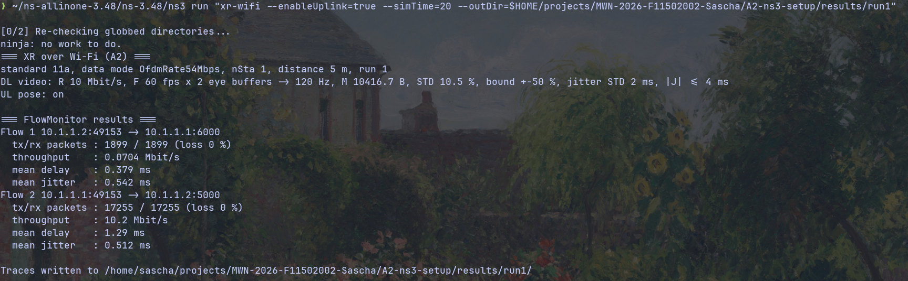
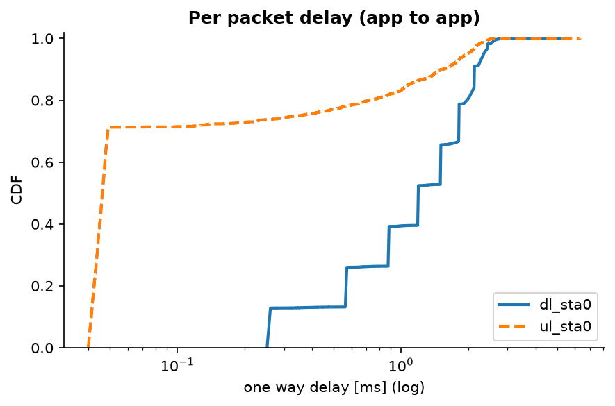
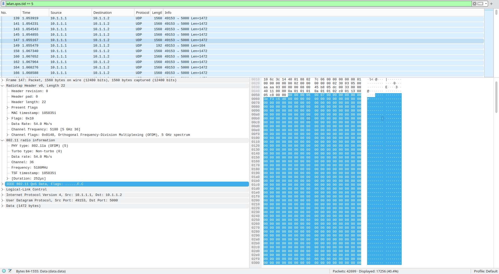
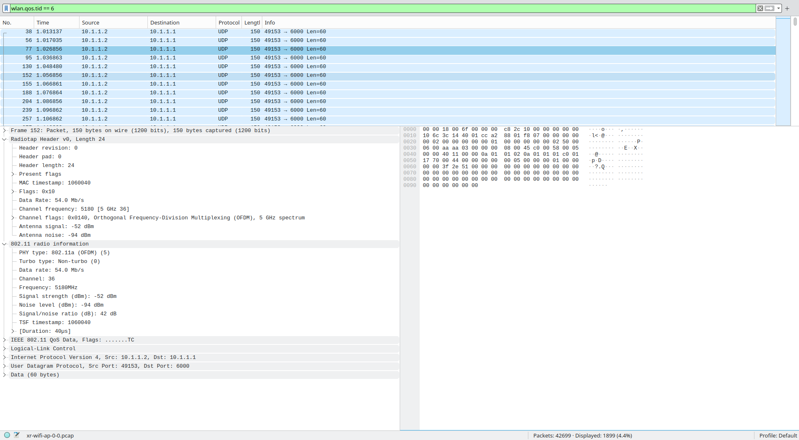
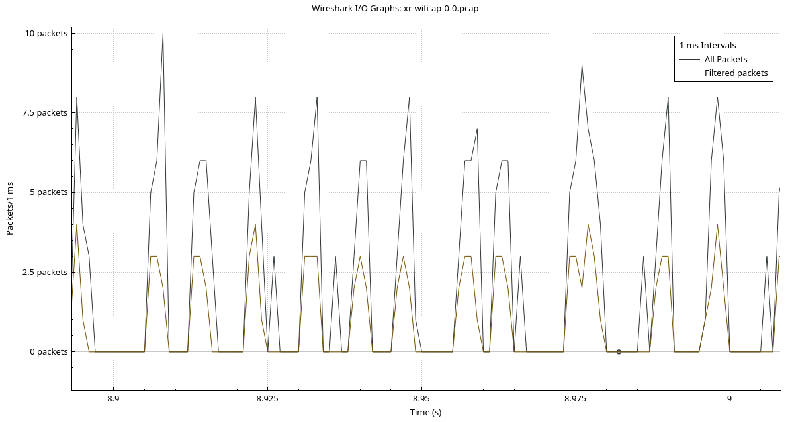
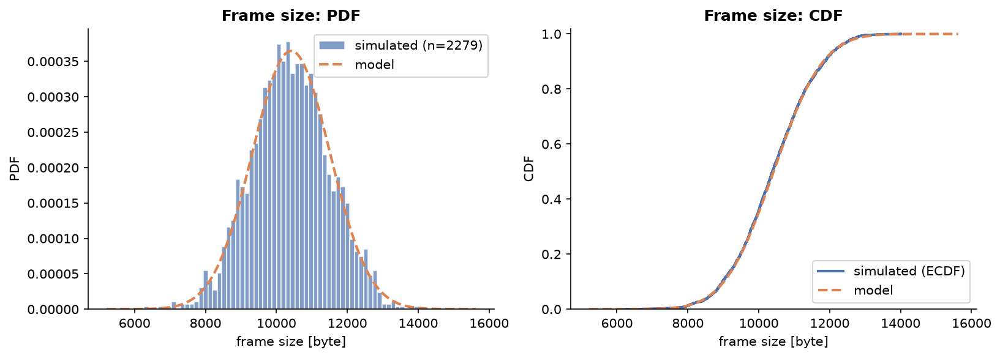
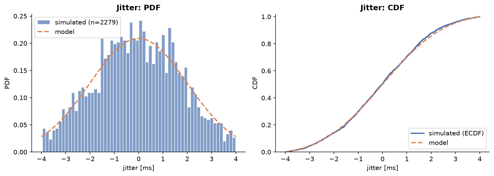
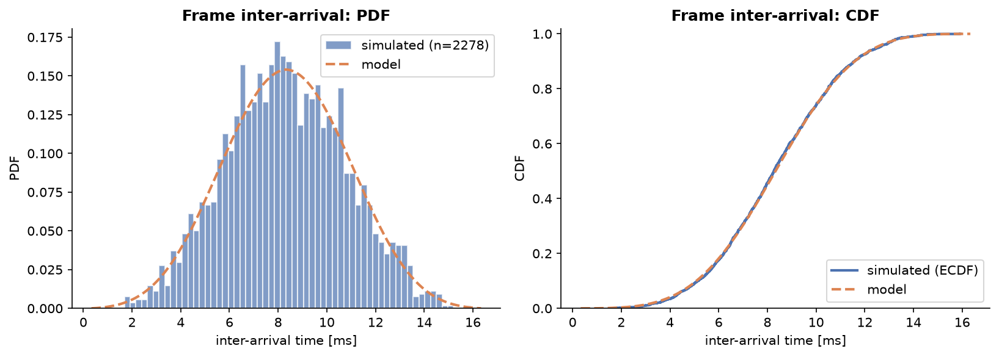
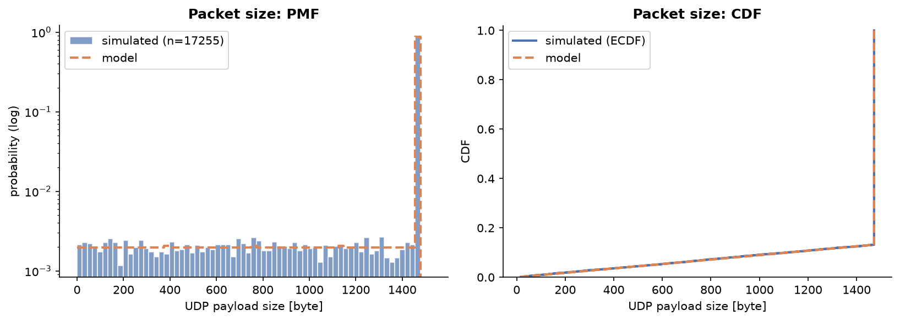

# First Scenario: 3GPP XR Traffic over 802.11 EDCA

- [First Scenario: 3GPP XR Traffic over 802.11 EDCA](#first-scenario-3gpp-xr-traffic-over-80211-edca)
  - [0 Overview](#0-overview)
  - [1 Specification](#1-specification)
    - [1.1 TR, not TS](#11-tr-not-ts)
    - [1.2 Choice of the model](#12-choice-of-the-model)
  - [2 Traffic Model](#2-traffic-model)
    - [2.1 Downlink XR video](#21-downlink-xr-video)
    - [2.2 Uplink pose](#22-uplink-pose)
    - [2.3 Parameter choices](#23-parameter-choices)
  - [3 Traffic Generator](#3-traffic-generator)
    - [3.1 Built-in or custom](#31-built-in-or-custom)
    - [3.2 Design](#32-design)
    - [3.3 Use of AI](#33-use-of-ai)
  - [4 Scenario](#4-scenario)
    - [4.1 Topology and stack](#41-topology-and-stack)
    - [4.2 Assumptions](#42-assumptions)
  - [5 Build and Run](#5-build-and-run)
  - [6 Results](#6-results)
    - [6.1 FlowMonitor](#61-flowmonitor)
    - [6.2 Wireshark](#62-wireshark)
    - [6.3 Plausibility check with an airtime model](#63-plausibility-check-with-an-airtime-model)
  - [7 Traffic Model Verification](#7-traffic-model-verification)
  - [8 Issues Encountered](#8-issues-encountered)
  - [9 Limitations and Next Steps](#9-limitations-and-next-steps)


## 0 Overview

| Item | Value |
| :--- | :--- |
| Simulator | ns-3.48 on Fedora Linux 44 (platform details in [installation_process.md](installation_process.md)) |
| Traffic model | 3GPP TR 26.926 V19.0.0, clause 6.5.3 (XR split rendering, statistical model from TR 38.838) and clause 5.9.2 (pose uplink) |
| Generator | Custom ns-3 application `XrTrafficApp`, [source](../src/xr-wifi/) |
| Scenario | 1 AP and 1 STA, 802.11a with QoS (EDCA), DL XR video on AC_VI, UL pose on AC_VO |
| Runs | 2 independent replications (run number 1 and 2), 20 s each |
| Evidence | FlowMonitor numbers, PCAP opened in Wireshark, PDF/CDF of frame size, packet size, jitter and inter-arrival time against the model |


## 1 Specification

### 1.1 TR, not TS

The assignment refers to "3GPP TS 26.926". The document behind the link is the **Technical Report 3GPP TR 26.926 V19.0.0 (2025-03), Release 19**, *Traffic Models and Quality Evaluation Methods for Media and XR Services in 5G Systems*. A TS with this number does not exist.

| | TS (Technical Specification) | TR (Technical Report) |
| :--- | :--- | :--- |
| Nature | Normative, defines what equipment *shall* do | Informative: studies, evaluation methods, models |
| Compliance | Implementations must conform | Nothing to conform to |
| Numbering | Typically xx.0xx to xx.8xx | xx.9xx |

The number itself shows the type: in 3GPP numbering, the 9xx range of a series (here series 26, codecs and media) is reserved for Technical Reports. The frame size and jitter model used here originates in a second report, TR 38.838 (RAN study on XR), so the whole model chain is informative. This is normal: traffic models are evaluation tools, not requirements.


### 1.2 Choice of the model

TR 26.926 contains several XR and media traffic descriptions. Most of them (cloud gaming, AR conversational, viewport dependent streaming) are **trace based**: they refer to packet traces that are not reproducible from the document alone. Clause 6.5.3 is the only description that is **fully parameterised by closed-form distributions** (Table 6.5.3.1-1 for the frame size, clause 6.5.3.2 for the jitter), and clause 5.9.2 gives a matching uplink pose model.

This has two advantages for this project:

- The generator can be implemented and verified analytically: every generated sample can be tested against a known PDF/CDF.
- The document also reports the statistics of real encoder traces (VR2-1 to VR2-8), so the model can be discussed against real data.

It also fits the project topic (EDCA prioritisation under a realistic multimedia traffic model, see A1 proposal): a periodic, bursty video stream on AC_VI is exactly the kind of traffic the Mangold et al. paper did *not* use.


## 2 Traffic Model

### 2.1 Downlink XR video

Frame size, TR 26.926 Table 6.5.3.1-1 (dual eye buffer, from TR 38.838):

| Parameter | Value used | Optional value in the TR |
| :--- | :--- | :--- |
| Distribution | Truncated Gaussian | |
| Mean M | $R \cdot 10^6 / (2F) / 8$ byte | same |
| STD | 10.5 % of M | 4 % of M |
| Min / Max | 50 % / 150 % of M | 88 % / 112 % of M |

Arrival times: periodic, plus a jitter that is modelled as a truncated Gaussian random variable added on top of the periodic arrivals (clause 6.5.3.2, referring to TR 38.838).

The factor 2 in M stands for the two eye buffers. The TR notes that trace VR2-6 sends the eye buffers **staggered**, which gives twice as many frames at half the size. The implementation follows this interpretation: one eye buffer of mean size M is generated every $1/(2F)$.

With R = 10 Mbit/s and F = 60 fps:

$$M = \frac{10 \cdot 10^6}{2 \cdot 60 \cdot 8} = 10\,417 \text{ byte}, \qquad T = \frac{1}{2F} = 8.33 \text{ ms}$$

### 2.2 Uplink pose

TR 26.926 clause 5.9.2: pose packets of 100 byte (60 byte payload and 40 byte header), sent every 10 ms, aligned with the rendering frame rate. The 40 byte header corresponds to IPv4 (20) + UDP (8) + RTP (12). ns-3 adds IP and UDP itself, so the application payload is 60 byte (no RTP is modelled).

### 2.3 Parameter choices

| Parameter | Value | Reason |
| :--- | :--- | :--- |
| R | 10 Mbit/s | The TR traces use 30 to 45 Mbit/s, which would saturate 802.11a. 10 Mbit/s keeps the load at roughly a third of the channel (see 6.3), so the first scenario is not dominated by overload |
| F | 60 fps | Common XR rendering rate |
| Frame size STD, bounds | 10.5 %, ±50 % | Baseline values of Table 6.5.3.1-1 |
| Jitter | STD 2 ms, truncated to ±4 ms | TR 38.838 baseline values as far as I know. They are not reproduced in TR 26.926 and still need to be checked against TR 38.838 itself |

The trace analysis in clause 6.5.3.2 reports a larger jitter (STD about 5 ms, 5 to 95 percentile range about ±8 ms). It is available via `--jitterStd=5 --jitterMax=8`. With ±8 ms and a period of 8.33 ms, consecutive eye buffers could swap order, which is one more reason to start with the smaller baseline values.

The trace frame sizes in TR 26.926 (for example mean 7378 byte at 30 Mbit/s for VR2-1) are not directly comparable to the formula, because the TR defines a frame as all packets with the same presentation timestamp and does not list the trace frame rate in that table.


## 3 Traffic Generator

### 3.1 Built-in or custom

| Option | Assessment |
| :--- | :--- |
| `OnOffApplication`, `UdpClient` | Fixed packet size, cannot produce a frame size distribution |
| `TgaxVideoTraffic` (ships with ns-3.48) | Video model of the IEEE 802.11ax evaluation methodology (Weibull frame size), not the 3GPP model |
| 5G-LENA (nr) XR generators | 3GPP based, but an external module tied to the NR stack, adds version coupling |
| **Custom application** | Exactly the TR 26.926 model, verifiable, reusable for A4 and the final project |

### 3.2 Design

Source files in [`src/xr-wifi/`](../src/xr-wifi/):

| File | Role |
| :--- | :--- |
| `xr-traffic-app.h/.cc` | `XrTrafficApp`, the generic generator |
| `xr-header.h/.cc` | 16 byte application header: frame id, fragment index, number of fragments, Tx timestamp |
| `xr-wifi.cc` | Scenario: topology, Wi-Fi, applications, traces, FlowMonitor, PCAP |

`XrTrafficApp` derives from `ns3::SourceApplication`. All model parameters are attributes, the distributions are `RandomVariableStream` pointers. The same class therefore produces both flows, only the configuration differs:

| Attribute | DL XR video | UL pose |
| :--- | :--- | :--- |
| `FrameRate` | 120 Hz (2 × 60 fps) | 100 Hz |
| `FrameSize` | Truncated normal (M = 10 417 B) | Constant 60 B |
| `Jitter` | Truncated normal (STD 2 ms, ±4 ms) | Constant 0 |
| `MaxPayloadSize` | 1472 B (fits a 1500 B IP MTU) | 1472 B |
| `Tos` | 0xb8 → UP 5 → AC_VI | 0xc0 → UP 6 → AC_VO |

Key design decisions:

- **Nominal grid.** Frame k is sent at $t_k = t_0 + (k+1)T + J_k$. The jitter is applied to the nominal grid and never to the previous send time, otherwise it would accumulate into a random walk.
- **Truncated Gaussian.** `ns3::NormalRandomVariable` with the `Bound` attribute rejects samples outside mean ± bound, which is exactly a symmetric truncated Gaussian.
- **Fragmentation.** A frame is split into UDP payloads of at most 1472 byte, filled to the maximum, the last one carrying the remainder. All fragments are handed to the socket at once, as an encoder would.
- **Access category.** ns-3 Wi-Fi maps the three most significant bits of the IP ToS byte to the 802.11 user priority (TID), which selects the EDCA queue.
- **Traces.** `FrameTx` and `PacketTx` trace sources log every generated frame and fragment. The receiver side reads the `XrHeader` to compute the one-way delay per packet.

### 3.3 Use of AI

As allowed by the assignment, the generator, the scenario and the verification script were generated with an AI assistant (Claude Opus 5.5) in a guided dialogue: I specified the model, the design and the reuse requirements, the assistant wrote the code. I built and ran everything myself, and the generated traffic is verified statistically against the specification (section 7). The verification found one real bug in the generated code (section 8).


## 4 Scenario

### 4.1 Topology and stack

```
 STA (10.1.1.2)  <---- DL XR video, UDP 5000, AC_VI ----  AP (10.1.1.1)
                 ----- UL pose,     UDP 6000, AC_VO ---->
                          distance 5 m
```

| Layer | Choice |
| :--- | :--- |
| Channel | `YansWifiChannel`, log distance path loss, channel 36 (5180 MHz), 20 MHz |
| PHY | 802.11a, as in the Mangold et al. paper |
| Rate control | `ConstantRateWifiManager`, data 54 Mbit/s, control 24 Mbit/s |
| MAC | Infrastructure BSS, QoS enabled (EDCA with ns-3 default parameters) |
| Network | IPv4, UDP, ARP pending queue increased to 64 packets (section 8) |
| Measurement | FlowMonitor, application traces (CSV), PCAP of AP and STA |

### 4.2 Assumptions

- The video source runs directly on the AP. There is no wired server behind it, since contention only happens on the wireless hop.
- One STA only, so there is no contention between stations yet. EDCA still matters between the two ACs (AC_VI on the AP, AC_VO on the STA).
- Constant rate, static positions at 5 m: no rate adaptation and practically no channel errors, so the results isolate the MAC behaviour.
- EDCA parameters and TXOP limits are the ns-3 defaults for an OFDM PHY. They are not yet set to the values of the paper (section 9).
- The applications run from 1 s to 20 s. The first second leaves time for association.


## 5 Build and Run

ns-3 was reconfigured to build only the modules the scenario needs (plus their dependencies). This reduced the build from over 1000 to well below 1000 targets. With ccache enabled, later rebuilds are fast.

```
ln -s ~/projects/MWN-2026-F11502002-Sascha/A2-ns3-setup/src/xr-wifi \
  ~/ns-allinone-3.48/ns-3.48/scratch/xr-wifi

cd ~/ns-allinone-3.48/ns-3.48
./ns3 configure --enable-modules="wifi;applications;internet;flow-monitor;mobility" --disable-examples --disable-tests
./ns3 build

./ns3 run "xr-wifi --enableUplink=true --simTime=20 --run=1 --outDir=$HOME/projects/MWN-2026-F11502002-Sascha/A2-ns3-setup/results/run1"
./ns3 run "xr-wifi --enableUplink=true --simTime=20 --run=2 --outDir=$HOME/projects/MWN-2026-F11502002-Sascha/A2-ns3-setup/results/run2"
```

The seed is fixed (`SetSeed(1)`) and `--run` selects the run number, i.e. an independent random number substream. This is the method ns-3 recommends for independent replications.

Analysis in a Python virtual environment (`requirements.txt` in the repository root):

```
source ~/projects/MWN-2026-F11502002-Sascha/.venv/bin/activate
cd ~/projects/MWN-2026-F11502002-Sascha/A2-ns3-setup
python scripts/plot_distributions.py --results results/run1
python scripts/plot_distributions.py --results results/run2
deactivate
```

Each run folder contains `config.txt` (all parameters), `flowmon.xml`, `plots/` and `plots/stats.md`. The CSV traces and PCAP files are regenerated by the run command and therefore excluded from Git.


## 6 Results

### 6.1 FlowMonitor



| Flow | Metric | Run 1 | Run 2 |
| :--- | :--- | ---: | ---: |
| DL video (AC_VI) | Tx / Rx packets | 17 255 / 17 255 | 17 246 / 17 246 |
| | Throughput | 10.20 Mbit/s | 10.20 Mbit/s |
| | Mean / max delay | 1.29 / 5.31 ms | 1.29 / 6.88 ms |
| | Mean jitter (FlowMonitor) | 0.51 ms | 0.51 ms |
| UL pose (AC_VO) | Tx / Rx packets | 1 899 / 1 899 | 1 899 / 1 899 |
| | Throughput | 0.070 Mbit/s | 0.070 Mbit/s |
| | Mean / max delay | 0.38 / 6.32 ms | 0.36 / 3.38 ms |

Throughput is measured from the first Tx to the last Rx packet and includes the IP and UDP headers, which is why the DL value is slightly above R = 10 Mbit/s. There is no loss in either run. The two runs agree in the mean values and differ only in the tails (maximum delay), as expected from independent replications.



### 6.2 Wireshark

The PCAP of the AP (`xr-wifi-ap-0-0.pcap`, radiotap link type) was opened in Wireshark.

**DL video**, filter `wlan.qos.tid == 5`:



- 802.11a OFDM at 54 Mbit/s on channel 36 (5180 MHz), QoS Data frames.
- 1560 byte captured per frame: 22 byte radiotap + 1538 byte MPDU (26 byte QoS MAC header, 8 byte LLC/SNAP, 20 byte IP, 8 byte UDP, 1472 byte payload, 4 byte FCS). The ToS byte 0xb8 is visible in the hex dump.
- The fragments of one eye buffer leave back to back (up to frame 149, which carries the 104 byte remainder). The next burst starts at 1.067 s, about 13 ms after the previous one: the 8.33 ms period plus the jitter difference of the two eye buffers.
- 17 256 frames are displayed, one more than FlowMonitor counts: one MAC retransmission (filter `wlan.fc.retry == 1`), which appears as a separate frame on the air.

**UL pose**, filter `wlan.qos.tid == 6`:



- 1899 frames, matching FlowMonitor. 60 byte payload, airtime 40 µs.
- Spacing of about 10 ms, as specified in TR 26.926 clause 5.9.2.
- Received signal -52 dBm, noise -94 dBm (SNR 42 dB): the link has a large margin, so losses are not expected.

**I/O graph**, 1 ms bins, filter `wlan.qos.tid == 5` (orange) against all packets (black):



- Bursts recur roughly every 8.33 ms, slightly irregular because of the jitter: the eye buffer structure of the traffic model is visible on the air.
- "All packets" is about twice the filtered curve because every data frame is followed by an ACK. The small peaks without an orange counterpart are pose frames with their ACKs.
- At most 3 to 4 data frames per millisecond, consistent with the 312 µs per frame exchange derived below.

### 6.3 Plausibility check with an airtime model

802.11a OFDM: 20 µs preamble and header, 4 µs symbols, $N_{DBPS} = 216$ bit at 54 Mbit/s and 96 bit at 24 Mbit/s, SIFS 16 µs, slot 9 µs.

| Frame | Size | Airtime |
| :--- | :--- | :--- |
| DL data (54 Mbit/s) | 1538 byte | $20 + 4\lceil(16 + 8 \cdot 1538 + 6)/216\rceil = 252$ µs |
| ACK (24 Mbit/s) | 14 byte | $20 + 4\lceil(16 + 112 + 6)/96\rceil = 28$ µs |
| UL pose data | 126 byte | $20 + 4\lceil(16 + 1008 + 6)/216\rceil = 40$ µs |

The 252 µs and 40 µs match the durations Wireshark reports.

**TXOP bursting.** Consecutive fragments of one frame are spaced exactly 312 µs apart in the capture (for example 1.053919 s and 1.054231 s), i.e.

$$T_{exch} = T_{DATA} + SIFS + T_{ACK} + SIFS = 252 + 16 + 28 + 16 = 312 \text{ µs}$$

There is no AIFS and no backoff between them. The AP wins the channel once per eye buffer and then sends the remaining fragments inside one EDCA TXOP (ns-3 default TXOP limit for AC_VI with an OFDM PHY: 3.008 ms, i.e. up to 9 exchanges). This differs from the Mangold et al. setup, which allows only one data frame per TXOP (section 9).

**Channel load.** Per eye buffer the AP needs one channel access (AIFS 34 µs plus on average 3.5 backoff slots, about 66 µs) and on average 7.6 exchanges:

$$\rho_{DL} \approx \frac{66 + 7.6 \cdot 312}{8333} \approx 29\,\%$$

The pose flow adds about 1 %. The channel is therefore far from saturation, consistent with zero loss. The upper bound for a single AC_VI flow with full TXOPs is about $1472 \cdot 8 / 312 \text{ µs} \approx 38$ Mbit/s of payload.

**DL delay.** Fragment i of a frame arrives after roughly $66 + (i-1) \cdot 312 + 252$ µs. Averaged over all fragments of a frame with about 7.6 fragments, $(i-1)$ is about 3.3, which gives about 1.35 ms. The measured mean of 1.29 ms agrees within 5 %. The delay of the XR video is thus dominated by the serialisation of the burst, not by contention.

**UL delay.** On an idle channel a pose packet needs about 0.1 ms (AIFS, short AC_VO backoff, 40 µs airtime). The measured mean is 0.37 ms with a 95th percentile of about 2 ms: a pose packet that arrives while the AP is inside a video TXOP has to wait until the TXOP ends, because EDCA prioritisation acts on channel access and does not pre-empt an ongoing TXOP. The higher priority AC_VO is delayed by the lower priority AC_VI burst. This is directly relevant for A4 and the final project.


## 7 Traffic Model Verification

`plot_distributions.py` compares the generated traffic (application side, `tx_frames.csv` and `tx_packets.csv`) against the analytical model and runs Kolmogorov-Smirnov (KS) tests. A high p-value means that no difference between the generated samples and the model is detectable.

Plots of run 1 (run 2: [plots folder](../results/run2/plots/)):






| Quantity | Statistic | Model | Run 1 | Run 2 |
| :--- | :--- | ---: | ---: | ---: |
| Frame size [B] | mean / STD | 10 417 / 1094 | ≈ 10 400 / 1092 | ≈ 10 410 / 1084 |
| | KS p-value | | 0.77 | 0.85 |
| Jitter [ms] | mean / STD | 0 / 1.76 | -0.03 / 1.72 | -0.01 / 1.74 |
| | KS p-value | | 0.25 | 0.24 |
| Inter-arrival [ms] | mean / STD | 8.333 / 2.49 | 8.332 / 2.45 | 8.333 / 2.42 |
| | KS p-value | | 0.73 | 0.48 |
| Packet size | share of 1472 B packets | 86.8 % | 86.8 % | 86.8 % |
| | packets per frame | 7.58 | 7.57 | 7.57 |

All KS p-values are well above 0.05 in both runs: the generated distributions are consistent with the model.

How the model columns follow from the specification:

- **Frame size truncation is practically inactive.** The bounds ±50 % of M lie at ±4.76 STD, so only about 2 in a million samples would be rejected. The distribution is effectively Gaussian (observed range 6268 to 14 008 byte).
- **Jitter truncation is active.** The bound ±4 ms is ±2 STD, which removes about 4.6 % of the Gaussian mass and reduces the STD from 2 ms to 1.76 ms. The measured 1.72 to 1.74 ms confirms the truncation, not the nominal 2 ms.
- **Inter-arrival time.** $\Delta_k = T + J_k - J_{k-1}$. With independent jitter samples the PDF is the convolution of the jitter PDF with itself (triangular-like shape on [T - 8, T + 8] ms), the mean stays T = 8.333 ms and the STD is $\sqrt{2} \cdot 1.76 = 2.49$ ms.
- **Packet size.** Fragmentation turns the continuous frame size into a mixture: most packets are full 1472 byte packets, plus one remainder packet per frame that is roughly uniformly distributed between 16 and 1472 byte. The model PMF is derived by fragmenting the analytical frame size PDF.
- **Packet level inter-arrival** at the application is bimodal (0 between fragments of one frame, about 8.3 ms between frames). The frame level inter-arrival is therefore the meaningful quantity to verify against the TR.


## 8 Issues Encountered

| Issue | Symptom | Cause | Fix |
| :--- | :--- | :--- | :--- |
| Jitter truncated to whole milliseconds | First verification failed: jitter KS p ≈ 0, histogram with spikes at integer values, STD 1.35 ms instead of 1.76 ms | `ns3::MilliSeconds()` only has integer overloads, so the double jitter value was truncated | `Time::FromDouble(value, Time::MS)` |
| 4 lost DL packets | Fragments with index 3 to 6 of the very first frame missing | The first frame is sent before ARP has resolved the STA. The ARP pending queue holds only 3 packets by default | `ArpCache::PendingQueueSize` set to 64 |
| Results in a folder named `~` | `--outDir=~/...` inside quotes | The shell does not expand `~` inside quotes, ns-3 does not either | Use `$HOME` |
| Long builds | Over 1000 targets, full rebuild after a change | Examples, tests and all modules enabled. Enabling ccache changes the compiler command, which triggers one full rebuild | Reduced module set, examples and tests disabled, ccache |

The first issue is the main lesson of this assignment: the generated code compiled and ran without warnings and produced plausible looking numbers. Only the comparison against the analytical distribution revealed the error.


## 9 Limitations and Next Steps

| Limitation | Next step |
| :--- | :--- |
| One STA, no contention between stations | A4: topology of Fig. 8 of the paper (1 AP, 3 STAs) |
| ns-3 default EDCA setup: 54/24 Mbit/s, TXOP bursting allowed | A4: 24/6 Mbit/s and one data frame per TXOP as in the paper; check that the EDCA parameters match Table 1 of the paper |
| Two replications only | A4: more runs per point, confidence intervals |
| Packet level metrics only | Frame level metrics (frame delay, frames within a delay budget) using the `XrHeader` at the receiver |
| Jitter parameters taken from TR 38.838 without checking the source | Verify against TR 38.838, possibly add the trace based variant (STD 5 ms) |
| PHY fixed to 802.11a | Keep 802.11a for the reproduction, newer standards only as an optional extension |