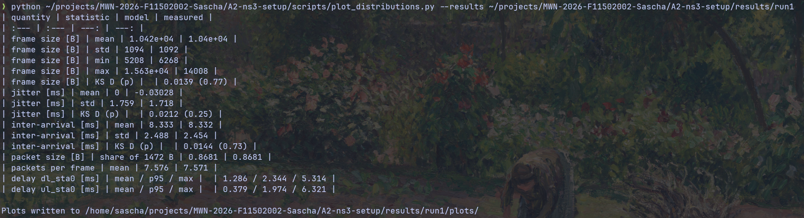

# <center>A2 — ns-3 Setup & First Scenario</center>
- [A2 — ns-3 Setup \& First Scenario](#a2--ns-3-setup--first-scenario)
  - [1. ns-3 Setup](#1-ns-3-setup)
  - [2. First Scenario](#2-first-scenario)
    - [2.1 Run commands](#21-run-commands)
    - [2.2 Analyzing](#22-analyzing)
    - [3.3 wireshark](#33-wireshark)


## 1. ns-3 Setup

I installed **ns-3.48** (the latest release as of 28.09.2026) on my laptop running **Fedora Linux 44**, following the official [installation guide](doc/ns-3-installation.pdf) from the [ns-3 website](https://www.nsnam.org/documentation/).

Nothing broke during installation, configuration or the build. The unit test suite passed (see the detailed documentation for the test summary).

The full installation process and the platform details are documented [here](doc/installation_process.md).


## 2. First Scenario

[Directory](src/) for the source Code

Creating Simlink in order to run src code from ns-3.48
```
ln -s ~/projects/MWN-2026-F11502002-Sascha/A2-ns3-setup/src/xr-wifi \
  ~/ns-allinone-3.48/ns-3.48/scratch/xr-wifi
```

### 2.1 Run commands

```
./ns3 configure --enable-modules="wifi;applications;internet;flow-monitor;mobility" --disable-examples --disable-tests

~/ns-allinone-3.48/ns-3.48/ns3 build

~/ns-allinone-3.48/ns-3.48/ns3 run "xr-wifi --enableUplink=true --simTime=20 --outDir=$HOME/projects/MWN-2026-F11502002-Sascha/A2-ns3-setup/results/run1"
```


for further runs change the run number, so a diffrent a diffrent number is chosen (fixed seed)
```
~/ns-allinone-3.48/ns-3.48/ns3 run "xr-wifi --enableUplink=true --simTime=20 --run=2 --outDir=$HOME/projects/MWN-2026-F11502002-Sascha/A2-ns3-setup/results/run2"
```


### 2.2 Analyzing

I also setup a venv to isolate the python dependencies

Plotting the run results
```
source ~/projects/MWN-2026-F11502002-Sascha/.venv/bin/activate

python ~/projects/MWN-2026-F11502002-Sascha/A2-ns3-setup/scripts/plot_distributions.py --results ~/projects/MWN-2026-F11502002-Sascha/A2-ns3-setup/results/run1

deactivate
```




### 3.3 wireshark

Wireshark from the first run [source](results/run1/xr-wifi-ap-0-0.pcap)


