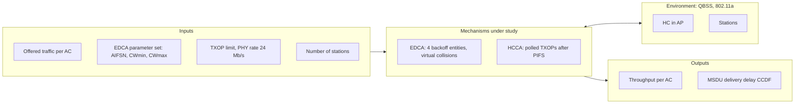
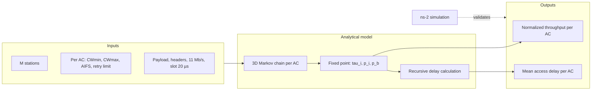
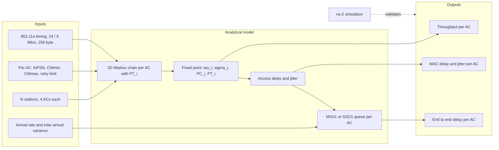

# 
Literature Review

- [Literature Review](#literature-review)
  - [1 Analysis of IEEE 802.11e for QoS support in wireless LANs](#1-analysis-of-ieee-80211e-for-qos-support-in-wireless-lans)
    - [1.2 System model](#12-system-model)
    - [1.3 Experimental results](#13-experimental-results)
    - [1.4 ns-3 settings for Fig. 8](#14-ns-3-settings-for-fig-8)
    - [1.5 What this means for my project](#15-what-this-means-for-my-project)
  - [2 Performance analysis of IEEE 802.11e contention-based channel access](#2-performance-analysis-of-ieee-80211e-contention-based-channel-access)
    - [2.1 Problem, importance, challenges, proposed method](#21-problem-importance-challenges-proposed-method)
    - [2.2 System model](#22-system-model)
    - [2.3 Experimental results](#23-experimental-results)
    - [2.4 ns-3 settings for Fig. 7](#24-ns-3-settings-for-fig-7)
    - [2.5 What this means for my project](#25-what-this-means-for-my-project)
  - [3 Throughput and delay performance of IEEE 802.11e enhanced distributed channel access (EDCA) under saturation condition](#3-throughput-and-delay-performance-of-ieee-80211e-enhanced-distributed-channel-access-edca-under-saturation-condition)
    - [3.1 Problem, importance, challenges, proposed method](#31-problem-importance-challenges-proposed-method)
    - [3.2 System model](#32-system-model)
    - [3.3 Experimental results](#33-experimental-results)
    - [3.4 ns-3 settings for Fig. 6](#34-ns-3-settings-for-fig-6)
    - [3.5 What this means for my project](#35-what-this-means-for-my-project)

## 1 Analysis of IEEE 802.11e for QoS support in wireless LANs 

[Source](https://ieeexplore.ieee.org/document/1265851):
S. Mangold, Sunghyun Choi, G. R. Hiertz, O. Klein and B. Walke, "Analysis of IEEE 802.11e for QoS support in wireless LANs," in IEEE Wireless Communications, vol. 10, no. 6, pp. 40-50, Dec. 2003, doi: 10.1109/MWC.2003.1265851. 

**Problem:**\
Legacy 802.11 offers no usable QoS. The DCF treats all traffic equally. The PCF is meant for time bounded traffic, but beacons can be delayed past the target beacon transmission time and the transmission time of a polled station is not under the control of the point coordinator, so delays are unpredictable.

**Importance:**\
Voice, video and other real time applications need differentiated service on WLANs. 802.11e was the upcoming amendment to provide it, so its mechanisms and their limits were directly relevant for the standard and for products.

**Challenges:**
1. Prioritisation must work in a distributed way, without central scheduling, and stay compatible with legacy stations (earliest access after DIFS).
2. Small contention windows favour high priority traffic but raise its collision probability as the number of stations grows.
3. Bounded delay requires a central coordinator (HC) that controls the medium, which fails when several QBSSs overlap.

**Proposed method:**\
The paper does not propose a new mechanism. It explains the hybrid coordination function (HCF) of the 802.11e draft and evaluates it with event driven stochastic simulations:
- EDCA: contention based access with four access categories (AC_VO, AC_VI, AC_BE, AC_BK), each with its own backoff entity and EDCA parameter set
- HCCA: controlled access, where the HC allocates TXOPs by polling after a PIFS, without backoff
- TXOP limit, block acknowledgment and the direct link protocol as efficiency improvements

Key definitions and parameters (taken from the paper):

| Definition | Meaning |
| :--- | :--- |
| $AIFS[AC] = SIFS + AIFSN[AC] \cdot aSlotTime$, $AIFSN[AC] \ge 2$ | Arbitration interframe space per AC; smaller AIFSN means higher priority, the earliest access is DIFS |
| First countdown at the end of the AIFS, transmission one slot after the counter reaches zero | EDCA backoff rule, different from the DCF |
| Virtual collision | If two backoff entities of one station reach zero in the same slot, the higher priority one transmits, the others act as if a collision had occurred |
| $CW_{min}[AC] < 15$ | Gives priority over legacy 802.11a stations when the AIFS equals DIFS |
| $TXOPlimit[AC]$ | Maximum duration a backoff entity may keep the medium after winning contention (several frames possible) |
| MSDU lifetime | Frames older than the maximum lifetime per AC are dropped instead of transmitted |

EDCA parameter sets (Table 1 in the paper):

| | AC_VO | AC_VI | AC_BE | AC_BK | AC_H | AC_M | AC_L |
| :--- | ---: | ---: | ---: | ---: | ---: | ---: | ---: |
| AIFSN | 2 | 2 | 3 | 7 | 2 | 4 | 7 |
| $CW_{min}$ | 3 | 7 | 15 | 15 | 7 | 10 | 15 |
| $CW_{max}$ | 7 | 15 | 1023 | 1023 | 7 | 31 | 255 |

AC_VO to AC_BK (from the 802.11e draft D5.0) are used for the throughput results, AC_H, AC_M and AC_L for the HCCA delay results.

### 1.2 System model

**Assumptions:**
- One isolated QBSS with the HC in the AP; two overlapping QBSSs for the last result
- Stations not hidden from each other (transmission powers and distances chosen accordingly)
- Simple traffic model on purpose, so that the traffic characteristics do not influence the MAC results
- No RTS/CTS, no fragmentation, no beacon frames
- One data frame per EDCA TXOP

**Environment:**\
802.11a PHY at 5 GHz with a radio channel error model, event driven stochastic simulation (the simulator is not named)

**Inputs:**
- Number of stations
- Per AC: AIFSN, $CW_{min}$, $CW_{max}$, TXOP limit
- Offered traffic per AC: number of streams, rate, MSDU size, arrival process
- PHY mode: data and control rate
- For HCCA: TXOP limit of the polled stream

**Outputs:**
- Throughput per AC
- MSDU delivery delay per stream

**Performance metrics:**
- Throughput per AC as a function of the offered traffic or of the number of stations
- Complementary CDF of the MSDU delivery delay, computed with the Limited Relative Error algorithm (maximum relative error 5 %)

### 1.3 Experimental results

**Setup:** (evaluation section of the paper)

| Parameter | Value |
| --- | --- |
| PHY | 802.11a, 5 GHz |
| Data rate | 24 Mb/s |
| Control rate | 6 Mb/s by default; all frames at 24 Mb/s for the Fig. 8 and Fig. 9 results |
| MSDU size | 512 byte |
| Arrival process | Negative exponential inter-arrival times |
| Default rate per stream | 250 kb/s |
| RTS/CTS, fragmentation, beacons | Not used |
| Frames per EDCA TXOP | One |
| EDCA parameters | Table 1 |
| Accuracy | Limited relative error ≤ 5 % |

The figures in the paper show:

| Figure | Scenario | Finding |
| :--- | :--- | :--- |
| 8 | The AP sends four streams, one per AC, to each of three stations (12 streams). Offered traffic per AC increased | With increasing load the higher priority ACs restrain the lower ones, thanks to smaller AIFSN, $CW_{min}$ and $CW_{max}$. The lower ACs drop out one after the other, AC_BK first and AC_VI last, while AC_VO keeps growing until the channel is saturated |
| 9 | Up to 16 stations, each with four streams of 250 kb/s (1 Mb/s per station) | Throughput collapses with many stations, AC_VO worst, because its small CW leads to many collisions. The authors see this as a parameter problem: the HC should adapt the EDCA parameter set, and in practice AC_VO carries much less traffic (one voice call per station) |
| 10 | AC_H, AC_M, AC_L parameters; the AP additionally sends an isochronous HCCA stream (80 byte, 128 kb/s). Isolated and overlapping QBSS | In an isolated QBSS the EDCA delays grow unpredictably with load, while the HCCA delay stays below the bound set by the TXOP limit. In overlapping QBSSs even the HCCA stream exceeds its bound (300 µs target), because the two HCs do not coordinate; if they always poll at the same time, the HCCA throughput drops to zero |

**Authors' conclusion:**\
802.11e is an efficient means of QoS support for a wide range of applications: EDCA provides relative prioritisation, HCCA time bounded service. The default EDCA parameters do not scale to many stations, and the overlapping QBSS problem is still open.

### 1.4 ns-3 settings for Fig. 8

| Item | Paper | ns-3.48 setting |
| :--- | :--- | :--- |
| Topology | 1 AP (HC), 3 stations, not hidden | 4 nodes, `ConstantPositionMobilityModel`, a few metres apart |
| Traffic | AP to stations only, 4 streams per station, one per AC | 12 UDP flows from the AP, AC selected by the ToS byte (as in A2) |
| Offered load | Swept along the x axis, 3 streams per AC | Sweep the per stream rate, offered load per AC from 0 to 30 Mb/s |
| Packets | 512 byte MSDU, negative exponential inter-arrival times | Exponential inter-arrival times in `XrTrafficApp` (to be added). Whether 512 byte is the MSDU or the UDP payload is not stated: choose and document |
| PHY | 802.11a, all frames at 24 Mb/s | `WIFI_STANDARD_80211a`, `ConstantRateWifiManager` with `DataMode` and `ControlMode` = `OfdmRate24Mbps` |
| EDCA | Table 1 (AC_VO to AC_BK) | As far as I know equal to the ns-3 defaults for OFDM; verify and set explicitly |
| MAC | One frame per TXOP, no RTS/CTS, no fragmentation | `TxopLimits` = 0 for all ACs (ns-3 default is non zero for AC_VO and AC_VI), `RtsCtsThreshold` and `FragmentationThreshold` above the frame size |
| Beacons | Not generated | ns-3 needs beacons or probing for association; keep them and document, or disable after association |
| Channel errors | Radio channel error model | Short distance, practically error free; documented deviation |
| Retry limit, MSDU lifetime | Not given | ns-3 defaults; set `WifiMacQueue` `MaxSize` and `MaxDelay` explicitly and report them |
| Simulation time, seeds, runs | Not given | 10 run numbers per point, 95 % confidence intervals, target half width ≤ 5 % of the mean (matching the 5 % relative error of the paper) |
| Metrics | Throughput per AC | FlowMonitor per flow, summed per AC |

### 1.5 What this means for my project

1. **Fig. 8 is my A4 baseline.** Reading the paper again for the ns-3 settings corrected three points of my A1 proposal:
   - Fig. 8 is a load sweep: the offered traffic per AC is the x axis. The 250 kb/s per stream is the default rate and belongs to Fig. 9.
   - For the Fig. 8 and Fig. 9 results all frames, including ACKs, are sent at 24 Mb/s
   - Only the AP transmits data in Fig. 8. The figure therefore tests contention between the four ACs of one station (virtual collisions), not contention between stations.

2. **Reproduction limits.** The simulator is not available, and simulation time, seeds, retry limit, MSDU lifetime and header sizes are not reported. ns-3 also needs beacons and will run without channel errors. I aim for a qualitative match (order and position of the drop of the lower ACs, AC_VO plateau). The models of Kong et al. and Huang and Liao with $N = 1$ can serve as an independent check of the saturated end of the curve.

3. **The gap my modification addresses.** The authors chose memoryless traffic on purpose and state themselves that correlated arrivals of realistic traffic would affect the throughput results. Replacing the AC_VI streams with a 3GPP TR 26.926 model at the same mean load tests exactly that.

4. **Metrics.** Fig. 8 only shows throughput. For my baseline I also record access delay and jitter per AC, so that the modification can be compared on delay as well, not only on throughput.

5. **TXOP.** The paper allows one frame per TXOP, although 802.11e allows several. In A2, ns-3 sent the fragments of an XR frame within one TXOP by default. The baseline uses one frame per TXOP as in the paper; the TXOP limit becomes a parameter of the modification.

## 2 Performance analysis of IEEE 802.11e contention-based channel access
[Source](https://ieeexplore.ieee.org/document/1362719): 
Zhen-ning Kong, D. H. K. Tsang, B. Bensaou and Deyun Gao, "Performance analysis of IEEE 802.11e contention-based channel access," in IEEE Journal on Selected Areas in Communications, vol. 22, no. 10, pp. 2095-2106, Dec. 2004, doi: 10.1109/JSAC.2004.836019.

### 2.1 Problem, importance, challenges, proposed method

**Problem:**\
Existing analytical models (Bianchi and successors) described the legacy DCF. They did not capture the new EDCA features: per AC AIFS and CW, virtual collisions, the EDCA backoff countdown rule and the retry limit. Earlier 802.11e studies were simulation only.

**Importance:**\
An analytical model explains *why* EDCA differentiates and how each parameter acts, which simulations alone do not show. It is the basis for parameter tuning and for call admission control (CAC), which the authors name as their next step.

**Challenges:**
1. Each AC behaves as a virtual station, so the model must be per AC, and the ACs of one station are coupled through virtual collisions.
2. Different AIFS values mean that a low priority AC can be frozen again before its AIFS has expired, so the freeze time depends on the other ACs causing dependencies.
3. EDCA decrements the backoff counter in the last slot of the AIFS, unlike the DCF 
4. The retry limit (packet discard) must be included, which earlier models omitted.
5. Mean access delay requires more than the stationary probabilities.

**Proposed method:**\
Each AC is modelled as its own discrete time Markov chain (one step per slot) with three dimensions: 
- backoff stage $j$ 
- backoff counter $k$ 
- remaining frozen, transmission or collision time $d$

The third dimension is what captures the AIFS freeze and the EDCA countdown rule. The chains of all ACs and stations are coupled through the collision probability $p_i$ of AC $i$ and the channel busy probability $p_b$, solved by a numerical fixed point. Throughput and a recursively computed mean access delay follow from the stationary distribution.

The equations I may need later for an analytical cross-check (taken form the paper):

| Equation | Meaning | in the paper |
| :--- | :--- | :--- |
| $AIFS[AC_i] = SIFS + AIFSN[AC_i] \cdot aSlotTime$ | Arbitration interframe space per AC | |
| $W_{j+1} = 2W_j + 1$, up to $CW_{max}$ | Contention window per backoff stage, counter uniform in $[0, W_j]$ | |
| $\tau_i = \dfrac{1-p_i^{\,m+h+1}}{1-p_i}\, b_{0,0,0}$ | Probability that AC $i$ attempts in a slot; $b_{0,0,0}$ from normalisation (5), $m+h$ = retry limit | (6)
| $\tau = 1 - \prod_{i}(1-\tau_i)$ | Probability that a station attempts (printed with a sum in the paper; it must be a product) | (7) |
| $p_i = 1 - (1-\tau)^{M-1} \prod_{i'>i}(1-\tau_{i'})$ | Collision probability of AC i: external (other $M-1$ stations) and virtual (higher ACs $i'$ of the same station) | (11) |
| $S_i = \dfrac{p_{si}\, E[P]}{E[I] + \sum_{i'} p_{si'}\,(T_s + AIFS[AC_{i'}]) + (1-\sum_{i'} p_{si'})\, T_c}$ | Normalized throughput of AC i: payload time over the mean time between two transmissions | (12) |
| $T_s = H + P + SIFS + ACK + AIFS$, $T_c = H + P + SIFS + ACK\_Timeout$  | Success and collision time, basic access  | (14) |

For $M = 1$ (a single transmitting station, as in Fig. 8 of Mangold et al.) the factor $(1-\tau)^{M-1}$ is 1, so only virtual collisions remain.

### 2.2 System model

**Assumptions:**
- Fixed number of $M$ stations, infrastructure mode (all traffic via the AP)
- every AC saturated: each AC queue always has a packet waiting
- Ideal channel (no transmission errors, no capture, no hidden stations)
- One data frame per TXOP
- $p_i$ and $p_b$ independent of the backoff state (Bianchi's decoupling assumption): every attempt collides with the same probability, regardless of how many collisions the packet has already suffered. This makes each AC's Markov chain solvable on its own

**Environment:**\
one BSS, 802.11b like PHY at 11 Mb/s, validated with ns-2

**Inputs:**
- $M$ stations
- Per AC: $CW_{min}$, $CW_{max}$, AIFS, retry limit
- Slot time, SIFS
- Payload and header sizes
- Data rate
- Access mode: basic (DATA, ACK) or RTS/CTS 

**Outputs:**
- $\tau_i$: probability that AC $i$ transmits in a randomly chosen slot
- $p_i$: collision probability of AC $i$
- - $p_b$: probability that the channel is busy in a slot
- Normalized throughput $S_i$ 
- Mean access delay per AC

**Performance metrics:**
- Normalized throughput per AC
- Mean access delay per AC
- Access delay CDF (simulation only)

### 2.3 Experimental results

**Setup:** (Table I in the paper) 

AC1 = low priority, AC3 = high priority;
Two saturated ACs per station 

| Paramter | Value |
| --- | --- |
| Payload Size | 1000 bytes |
| PHY Header (incl. preamble) | 192 bits|
| MAC Header (incl. CRC bits) | 272 bits|
| RTS Frame | PHY Header + 160 bits |
| CTS Frame | PHY Header + 112 bits |
| ACK Frame | PHY Header + 112 bits |
| CTS_Timeout | DIFS + CTS |
| ACK_Timeout | DIFS + ACK |
| Data Rate | 11 Mbpts |
| Time Slot | 20 µs |
| SIFS | 1 Time Slot |
| AIFS[AC3] | 3 Time Slots |
| AIFS[AC1] | 4 Time Slots |
| CW[AC3] | {15, 31, 63, 127} |
| CW[AC1] | {31, 63, 127, 255} |

The figures in the paper show: 

| Figure | Varied | Finding |
| :--- | :--- | :--- |
| 7, 8 | Number of stations | AC3 keeps an almost constant share of the channel, AC1 loses about half of its share. AC1 delay grows much faster than AC3 delay and has a long tail. Model and simulation agree well for AC3; for AC1 the model is above the simulation at high load |
| 9 | CWmin of AC3 | A smaller CW gives AC3 more share and less delay, at the cost of AC1. The effect weakens as the number of AC3 flows grows, because most collisions are then among AC3 flows |
| 10 | AIFS of AC1 | AIFS differentiates more strongly than CW. One extra AIFS slot for AC1 increases its delay sharply under high load while AC3 hardly gains: the low priority AC can starve |
| 11, 12 | Stations with only AC3 or only AC1 | The number of high priority flows, not the total number of stations, decides what is left for the low priority AC |

**Authors' conclusion:**\
The model captures EDCA differentiation, and the high priority load has to be limited (call admission control) to keep the low priority ACs usable.

### 2.4 ns-3 settings for Fig. 7

| Item | Paper | ns-3.48 setting |
| :--- | :--- | :--- |
| Topology | $M$ stations, infrastructure | 1 AP and $M$ = [5, 30] STAs, all within range |
| Traffic | Two saturated ACs per station, 1000 byte; direction not stated | Per STA one UDP flow on AC_VO (AC3) and one on AC_BK (AC1), STA to AP, rate far above capacity |
| PHY | 11 Mb/s, slot 20 µs, SIFS 20 µs | `WIFI_STANDARD_80211b`, `DsssRate11Mbps`. ns-3 uses the standard SIFS of 10 µs and a real 802.11b preamble |
| EDCA | AIFSN 2 and 3, CW 15 to 127 and 31 to 255 | `Aifsns`, `MinCws`, `MaxCws` per AC |
| MAC | RTS/CTS, one frame per TXOP, retry limit not given | `RtsCtsThreshold` = 0, `TxopLimits` = 0, ns-3 default retry limit |
| Simulation time, seeds, runs | Not given | As in the Mangold reproduction: 10 run numbers, 95 % confidence intervals |
| Metrics | Normalized throughput, mean access delay | FlowMonitor for throughput; access delay from head of line to ACK, from MAC traces |

### 2.5 What this means for my project

1. **Not a reproduction target.** Table I gives the PHY header as 192 bits (fixed offset) while ns-3 uses reats PHY headers as modular byte streams (implements the actual standard).
Therefore the absolute numbers will differ.
Simulation time, seeds and the ns-2 EDCA module are not reported either. I will use the paper as a qualitative reference, not as a baseline.

2. **Possible analytical cross-check.** In Fig. 8 of Mangold et al. the AP is the only transmitter. With $M = 1$ the model reduces to virtual collisions between the four ACs of one station. Fed with the ns-3 frame durations, it gives an independent prediction of the saturated end of Fig. 8. Whether I use this model for the final report is still open.

3. **What to expect in my results.** AIFS differentiation can starve AC_BE and AC_BK, and the high priority load determines what is left for them. 
In the final project this is exactly what may change when AC_VI carries bursty 3GPP traffic instead of Poisson traffic.

4. **Delay definition.** The paper's access delay is a MAC level delay. I define mine explicitly (head of line until ACK) and report end to end delay separately.

5. **Limits of the model.** It assumes saturation and one frame per TXOP. Real XR traffic is neither saturated nor sends one frame per TXOP, so the model covers only the saturated baseline point, not the modification.

## 3 Throughput and delay performance of IEEE 802.11e enhanced distributed channel access (EDCA) under saturation condition

[Source](https://ieeexplore.ieee.org/document/4114263):
C. -l. Huang and W. Liao, "Throughput and delay performance of IEEE 802.11e enhanced distributed channel access (EDCA) under saturation condition," in IEEE Transactions on Wireless Communications, vol. 6, no. 1, pp. 136-145, Jan. 2007, doi: 10.1109/TWC.2007.04796.

### 3.1 Problem, importance, challenges, proposed method

**Problem:**\
Existing EDCA models extended from Bianchi either ignored virtual collisions inside a station, ignored the effect of different AIFS values on the backoff of lower ACs, or only gave the saturation throughput. Delay and jitter were not modelled.

**Importance:**\
Multimedia applications care about delay and jitter more than about throughput. A model that gives throughput, access delay, jitter and queueing delay per AC supports QoS design and admission decisions.

**Challenges:**
1. Virtual collisions inside a station and external collisions between stations have to be separated.
2. A lower priority AC can only decrement its counter if the channel stays idle for its longer AIFS, which depends on all higher priority ACs.
3. The retry limit (frame discard) must be included.
4. Jitter requires the variance of the access delay, not only its mean.
5. End to end delay depends on the arrival process, which a saturation model does not contain.

**Proposed method:**\
Each AC is modelled as its own Bianchi style discrete time Markov chain with two dimensions:
- backoff stage $s(t)$
- backoff counter $b(t)$

The AIFS effect is captured by an extra probability $PT_i$ that the counter of AC $i$ is actually decremented in a slot, instead of a third dimension as in Kong et al. Collisions are split into virtual ($PI_i$) and external ($PO$). Access delay and jitter follow from the mean and variance of the total backoff, approximated as geometric. Queueing delay is added by treating each AC as an M/G/1 queue (Poisson arrivals) or a G/G/1 queue (general arrivals).

Notation differs from Kong et al.: $N$ is the number of stations, AC0 is the **highest** priority, $M_i$ is the number of CW doublings and $M_i + f_i$ the retry limit of AC $i$.

The equations I may need later for an analytical cross-check (taken from the paper):

| Equation | Meaning | in the paper |
| :--- | :--- | :--- |
| $W_{k,i} = W_{0,i} \cdot 2^k$, up to $W_{M_i,i}$ | Contention window per backoff stage, counter uniform in $[1, W_{k,i}]$ (the standard and ns-3 use $[0, W]$) | II, (1) |
| $b_{0,0} = \dfrac{2PT}{\frac{(1+2PT)(1-PC^{M+f+1}) + W_0 (2PC)^M (1-PC^{f+1})}{1-PC} + \frac{W_0 (1-(2PC)^M)}{1-2PC}}$ | Stationary probability of state (0,0), from normalisation | (2) |
| $\tau_i = \sum_{k=0}^{M_i+f_i} b_{k,0} = b_{0,0} \sum_{k=0}^{M_i+f_i} PC_i^{\,k}$ | Probability that AC $i$ attempts in a slot (seen inside the station). The closed form printed in (3) does not match (2): it has $(1+2PC)$ where (2) has $(1+2PT)$. Use (2) with this sum | text before (3) |
| $PC_i = PI_i + (1 - PI_i)\, PO$ | Collision probability of AC $i$: virtual or external | (4) |
| $PI_i = 1 - \prod_{j<i}(1-\tau_j)$ | Virtual collision probability: AC $i$ collides only with higher priority ACs of its own station | (5) |
| $\sigma_i = \tau_i (1 - PI_i)$, $\sigma_{total} = \sum_i \sigma_i$ | Probability that AC $i$ actually transmits on the channel (seen outside the station) | (6) |
| $PO = 1 - (1-\sigma_{total})^{N-1}$ | External collision probability with the other $N-1$ stations | (7) |
| $PT_1 = \left((1-\tau_0)(1-\sigma_0)^{N-1}\right)^{diff_1 - diff_0}$, $PT_2$ and $PT_3$ analogous | Probability that the counter is decremented: no higher priority AC transmits in the extra AIFS slots; $diff_i = (AIFS_i - AIFS_{min})/aSlotTime$ | (8) |
| $PTR = 1-(1-\sigma_{total})^N$, $PS_i = \dfrac{N \sigma_i (1-\sigma_{total})^{N-1}}{PTR}$, $PFC = \dfrac{1-(1-\sigma_{total})^N - N \sigma_{total} (1-\sigma_{total})^{N-1}}{PTR}$ | Probability of a transmission in a slot, of a success of AC $i$, of a collision | (9) |
| $S_i = \dfrac{PS_i \cdot PTR \cdot E[L_i]}{(1-PTR)\, aSlotTime + \sum_j PTR \cdot PS_j\, t_{s_j} + PTR \cdot PFC\, t_c}$ | Saturation throughput of AC $i$: payload per mean slot duration (idle, success, collision) | (10) |
| $t_{s_i} = t_H + t_{E[P_i]} + t_{SIFS} + \delta + t_{ACK} + t_{AIFS_i} + \delta$, $t_c = t_H + t_{E[P^*]} + t_{AIFS_i} + \delta$ | Success and collision time, basic access (RTS/CTS version in (12)) | (11) |
| $J_i = \sqrt{Var[AD_i]}$ | Jitter = standard deviation of the access delay $AD_i$; mean and variance of $AD_i$ in (18), (19) | (19) |
| $E[Q_i] \le \dfrac{\lambda_i (\alpha_i + Var[T_i])}{2(1 - \lambda_i E[T_i])}$ | Upper bound of the queueing delay for general arrivals (G/G/1); $\lambda_i$ arrival rate, $\alpha_i$ variance of the inter-arrival time, $T_i$ service time from (20); lower bound also in (22) | (22) |

For $N = 1$ (a single transmitting station, as in Fig. 8 of Mangold et al.) $PO = 0$, so $PC_i = PI_i$ and $PT_i$ only contains the factors $(1-\tau_j)$ of the own station.

### 3.2 System model

**Assumptions:**
- Fixed number of $N$ stations, infrastructure mode
- Every AC saturated: each AC queue always has a frame waiting
- Ideal channel (no transmission errors, no hidden stations, no capture)
- All ACs in all stations see the same collision probability (Bianchi's assumption)
- Virtual collisions are resolved in negligible time
- Backoff counter drawn from $[1, W]$
- One data frame per channel access, TXOP bursting is not modelled
- Delay analysis: no frame is discarded

**Environment:**\
one BSS, 802.11a OFDM timing, uplink only (stations to AP), validated with the ns-2 EDCA module of Chesson and Singla

**Inputs:**
- $N$ stations
- Per AC: AIFSN, $CW_{min}$, $CW_{max}$, retry limit
- Slot time, SIFS, propagation delay
- Payload and header sizes
- Data and control rate
- Access mode: basic (DATA, ACK) or RTS/CTS
- For the queueing part: arrival rate $\lambda_i$ and inter-arrival variance $\alpha_i$ per AC

**Outputs:**
- $\tau_i$: probability that AC $i$ attempts in a slot
- $\sigma_i$: probability that AC $i$ actually transmits on the channel
- $PC_i$: collision probability of AC $i$
- $PT_i$: probability that the backoff counter of AC $i$ is decremented in a slot
- Saturation throughput $S_i$
- Mean access delay and jitter per AC
- Mean queueing delay and end to end delay per AC

**Performance metrics:**
- Aggregate throughput per AC
- MAC to MAC delay: from the moment the head of line frame starts contending until it reaches the MAC of the receiver
- MAC to MAC jitter: standard deviation of the MAC to MAC delay
- End to end delay: from the UDP layer of the sender to the UDP layer of the receiver, including queueing

### 3.3 Experimental results

**Setup:** (Table II in the paper)

AC0 = highest priority, AC3 = lowest priority;
Four saturated ACs per station, each a CBR UDP flow to the AP

| Parameter | Value |
| --- | --- |
| Data Transmission Rate | 24 Mbps |
| Control Message Transmission Rate | 6 Mbps |
| Bytes per OFDM symbol | 27 |
| Idle slot time | 9 µs |
| SIFS | 16 µs |
| DIFS | SIFS + 2 slots = 34 µs |
| Propagation delay | 1 µs |
| Maximum number of stations | 25 |
| RTS / CTS / ACK frame | 20 / 14 / 14 octets |
| Data payload | 256 octets |
| MAC sublayer overhead | 28 octets |
| PHY layer overhead | 20 µs |
| OFDM symbol interval | 4 µs |
| CBR sending interval per AC | 1 ms |
| Retry limit | 7 |

| EDCA parameters | AC0 | AC1 | AC2 | AC3 |
| :--- | :--- | :--- | :--- | :--- |
| Set 1: ($CW_{min}$, $CW_{max}$), AIFS | (15, 31), SIFS + 2 slots | (31, 63), SIFS + 3 slots | (31, 127), SIFS + 4 slots | (63, 255), SIFS + 4 slots |
| Set 2: ($CW_{min}$, $CW_{max}$), AIFS | (31, 63), SIFS + 2 slots | (63, 127), SIFS + 2 slots | (127, 255), SIFS + 3 slots | (127, 255), SIFS + 7 slots |

The figures in the paper (RTS/CTS mode only, $N$ = 10 to 25) show:

| Figure | Metric | Finding |
| :--- | :--- | :--- |
| 6 | Aggregate throughput per AC | AC0 takes most of the capacity in both sets and stays almost constant with $N$, AC3 gets almost nothing. The lower ACs lose throughput as $N$ grows. In set 2, where AC0 and AC1 share the same AIFS, AC1 gets a clearly larger share than in set 1 |
| 7 | MAC to MAC delay | The delay of the low priority ACs grows steeply with $N$ and reaches seconds at $N$ = 25, while the high priority ACs stay low |
| 8 | MAC to MAC jitter | The jitter follows the delay and is of the same order of magnitude: low priority traffic is not only late but also very irregular |
| 9 | End to end delay | Dominated by queueing: under saturation the queues of the low priority ACs keep growing, so the delay reaches tens of seconds |

In all figures the analytical curves (solid) match the simulation curves (dashed) closely. The legends label both as "sim", so model and simulation can only be told apart by the line style.

**Authors' conclusion:**\
The model accurately describes EDCA throughput, delay and jitter under saturation. The close match also supports the geometric approximation used for the variance of the total backoff.

### 3.4 ns-3 settings for Fig. 6

| Item | Paper | ns-3.48 setting |
| :--- | :--- | :--- |
| Topology | $N$ stations and an AP, no traffic between stations | 1 AP and $N$ = [10, 25] STAs, all within range |
| Traffic | Four CBR UDP flows per station, one per AC, 256 byte, 1 ms interval, STA to AP | Per STA four UDP flows, AC selected by ToS: AC0 → AC_VO, AC1 → AC_VI, AC2 → AC_BE, AC3 → AC_BK (keeps the internal collision order) |
| Offered rate | Text says 1 Mbps per AC, Table II gives 256 byte every 1 ms (2 Mbps) | Irrelevant for saturation as long as the load is far above capacity; use the Table II values and document it |
| PHY | 24 Mb/s data, 6 Mb/s control, 802.11a timing | `WIFI_STANDARD_80211a`, `OfdmRate24Mbps` / `OfdmRate6Mbps`. Slot, SIFS and DIFS are the ns-3 defaults. Table II lists 27 bytes per OFDM symbol, which is the 54 Mb/s value (24 Mb/s carries 12) |
| EDCA | Set 1 and set 2 | `Aifsns`, `MinCws`, `MaxCws` per AC, set on the AP and the STAs |
| Backoff | Counter in $[1, W]$ | ns-3 uses $[0, W]$, documented deviation |
| MAC | RTS/CTS shown, retry limit 7, one frame per access | `RtsCtsThreshold` = 0, `TxopLimits` = 0, retry limit 7 |
| Queue | Not given | Large `WifiMacQueue` `MaxSize` and `MaxDelay`; only matters for the end to end delay |
| Simulation time, seeds, runs | Not given | As in the Mangold reproduction: 10 run numbers, 95 % confidence intervals |
| Metrics | Throughput, MAC to MAC delay, jitter, end to end delay | FlowMonitor for throughput and end to end delay; MAC delay from head of line to ACK, from MAC traces |

### 3.5 What this means for my project

1. **Closer to the Mangold setup.** Same 802.11a timing, 24 Mb/s data, four ACs per station. If I do the analytical cross-check, this model is the simpler one to implement (two dimensional chain, explicit expressions for all probabilities). With $N = 1$ it reduces to virtual collisions only, as in Fig. 8 of Mangold et al. Fig. 6 is also a possible multi station validation of ns-3 EDCA, which is still optional.

2. **Reproduction limits.** The backoff interval $[1, W]$ differs from the standard and simulation time, seeds and queue size are not reported. Fig. 6 can therefore be reproduced qualitatively; the absolute values may differ.

3. **Metric definitions.** I adopt the MAC to MAC delay and jitter definitions to separate access delay from queueing delay. My own definition (head of line until ACK) is almost the same; it only additionally includes the SIFS and the ACK.

4. **Limits of the model.** Like Kong et al., it assumes saturation and one frame per channel access. Bursty XR traffic with TXOP bursting is outside the validated part of the model, so it covers only the saturated baseline point, not the modification.