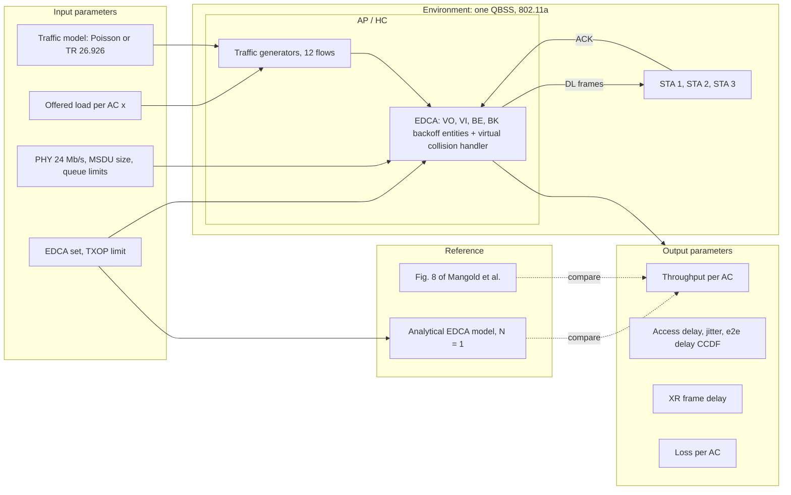

# 
 Project Proposal 

- [ Project Proposal ](#-project-proposal-)
  - [Basic Information](#basic-information)
  - [1. Project Abstract](#1-project-abstract)
  - [2. System Architecture](#2-system-architecture)
    - [2.1 System Assumptions](#21-system-assumptions)
    - [2.2 Environment](#22-environment)
    - [2.3 Input Parameters](#23-input-parameters)
    - [2.4 Output Parameters](#24-output-parameters)
    - [2.5 Control modules](#25-control-modules)
  - [3. Expected Outputs](#3-expected-outputs)
    - [3.1 Validation Method](#31-validation-method)
    - [3.2 Experiment Scenario 1: Baseline reproduction (A4)](#32-experiment-scenario-1-baseline-reproduction-a4)
    - [3.3 Experiment Scenario 2: Analytical cross-check (A4)](#33-experiment-scenario-2-analytical-cross-check-a4)
    - [3.4 Experiment Scenario 3: 3GPP traffic on AC\_VI (final project)](#34-experiment-scenario-3-3gpp-traffic-on-ac_vi-final-project)
  - [4 Cross-Validation](#4-cross-validation)
- [Changes since the A1 proposal](#changes-since-the-a1-proposal)

Structure taken from the sample planning template. 
References: [P1] Mangold et al. 2003, [P2] Kong et al. 2004, [P3] Huang and Liao 2007, details in [Literature Review](literature-review.md).

## Basic Information

| Field | Content |
|---|---|
| Project Title |	EDCA Prioritisation under 3GPP Multimedia Traffic: Reproducing Fig. 8 of Mangold et al. in ns-3 |
| Student ID / Name | F11502002 Sascha Furrer|
| Path | Basic (802.11e reproduction) |

## 1. Project Abstract
In 150–300 words, describe:
- **Problem being solved:**
- **Challenges of this problem:**
- **Planned approach / methods:**
- **Expected final deliverable:**

**Problem to be solved:**\
Mangold et al. [P1] show in Fig. 8 that EDCA restrains lower access categories in favour of higher ones as the offered load rises. 
The result is obtained with memoryless traffic: 512 byte MSDUs with exponential inter-arrival times. 
Multimedia traffic is periodic and bursty.
The project asks whether the prioritisation, and the capacity left to lower ACs, still behave as in Fig. 8 when the video AC carries such a stream at the same mean load.

**Key challenges:**\
The original simulator is not available and the paper omits simulation time, seeds and frame overheads, so the ns-3 baseline needs an independent check. 
A fair comparison must change only the burstiness, not the mean load. 
Mean throughput hides starvation and tail delay, and packet level delay is not frame level delay. 
All reviewed papers use one frame per TXOP, while bursty traffic interacts with TXOP bursting.

**Proposed method:**\
Reproduce Fig. 8 in ns-3 with the settings of [P1]. Check the saturated end against an analytical EDCA model ([P2] or [P3]) evaluated with the ns-3 frame durations.\
Then replace the AC_VI Poisson streams with a TR 26.926 model and sweep its mean rate along the same axis, with TXOP limit 0 and the ns-3 default as two variants.

**Expected outcomes:**\
 A documented ns-3 baseline that matches Fig. 8 qualitativly, an analytical cross-check, and a quantified comparison of throughput share, access delay, jitter, frame delay and loss per AC between Poisson and 3GPP traffic.

## 2. System Architecture

### 2.1 System Assumptions

- One isolated QBSS, 802.11a at 5 GHz, all stations within range (no hidden stations), static positions.
- Error free channel in practice (short distances, constant rate). This deviates from [P1], which used a radio error model.
- Only the AP transmits data in the baseline (as in Fig. 8 of [P1]); stations send ACKs only.
- EDCA parameter set of Table 1 of [P1], one data frame per TXOP in the baseline.
- No RTS/CTS, no fragmentation, no aggregation (not available in 802.11a).
- MAC queue size and lifetime (`WifiMacQueue` `MaxSize`, `MaxDelay`) set explicitly and reported.

### 2.2 Environment

- **Access point (HC):** hosts all traffic sources and the four EDCA backoff entities (AC_VO, AC_VI, AC_BE, AC_BK).
- **Stations 1 to 3:** receivers, one flow per AC each.
- **Wireless medium:** shared 20 MHz channel, all frames at 24 Mb/s.

### 2.3 Input Parameters

| Symbol | Meaning |
| :--- | :--- |
| $x$ | Offered load per AC (3 streams each), swept 0 to 30 Mb/s |
| traffic model | Poisson (baseline) or TR 26.926 model on AC_VI (modification) |
| $R$, $F$ | Mean rate and frame rate of the 3GPP stream, $R$ chosen so that the AC_VI load equals $x$ |
| $L$ | MSDU size (512 byte baseline) |
| AIFSN, CWmin, CWmax | EDCA parameter set per AC |
| TXOPlimit | 0 (baseline) or ns-3 default (variant) |
| PHY rate | 24 Mb/s data and control |
| `MaxSize`, `MaxDelay` | MAC queue limits |

### 2.4 Output Parameters

| Symbol | Meaning |
| :--- | :--- |
| $S_{AC}$ | Throughput per AC [Mb/s] |
| $D_{acc}$ | MAC access delay per AC (head of line to ACK), mean and standard deviation (jitter, as defined in [P3]) |
| $D_{e2e}$ | End to end delay per AC, CCDF as in [P1] |
| $D_{frame}$ | XR frame delay (last fragment received), share of frames within a delay budget |
| $p_{loss}$ | Loss per AC, split into retry limit drops and queue drops (size or `MaxDelay`) |

### 2.5 Control modules

The project does not design a new controller. The modules are the mechanism under study and the parts that are swapped or checked:

| Module | Role | Changed in the project? |
| :--- | :--- | :--- |
| EDCA (4 backoff entities, virtual collision handler) | Mechanism under study | Only the TXOP limit, as a variant |
| Traffic generator (`XrTrafficApp`, extended with exponential inter-arrival) | Source of the offered load | Yes: Poisson vs 3GPP model |
| Analytical EDCA model ([P2] or [P3], Python) | Independent reference for the saturated baseline | New |
| Measurement (FlowMonitor, MAC traces, application header) | Metrics above | Extended with MAC and frame level delay |

## 3. Expected Outputs

### 3.1 Validation Method

- **Experimental environment:** ns-3.48 on Fedora Linux 44, discrete event simulation, one QBSS, 1 AP and 3 STAs, 802.11a, 24 Mb/s, `ConstantRateWifiManager`, `YansWifiChannel`.
- **Software:** `XrTrafficApp` from A2 (extended), FlowMonitor, PCAP for spot checks in Wireshark, Python for analysis and the analytical model.
- **Statistics:** fixed seed, 10 run numbers per point, 95 % confidence intervals, target half width ≤ 5 % of the mean (matching the 5 % limited relative error of [P1]). 1 s association phase, 30 s measurement per point (to be confirmed by a convergence check).

### 3.2 Experiment Scenario 1: Baseline reproduction (A4)

- **Design:** Fig. 8 of [P1]. 12 downlink flows, Poisson, 512 byte MSDUs, Table 1 parameters, one frame per TXOP, all frames at 24 Mb/s. Sweep $x$ from 0 to 30 Mb/s per AC.
- **Baseline:** Fig. 8, digitised.
- **Purpose:** confirm that the ns-3 EDCA reproduces the order and position of the collapse of the lower ACs and the AC_VO plateau.
- **Expected result:** qualitative match (order BK, BE, VI) and saturated total throughput close to the airtime bound of ≈ 13.9 Mb/s; plateau values within a tolerance to be fixed after the first runs.

### 3.3 Experiment Scenario 2: Analytical cross-check (A4)

- **Design:** the saturated end of Scenario 1 ($x$ = 30 Mb/s, all four ACs backlogged). Implement the model of [P2] or [P3] for $N$ = 1 (virtual collisions only, $PO = 0$), using the ns-3 frame durations and the ns-3 backoff interval $[0, W]$.
- **Baseline:** ns-3 throughput per AC from Scenario 1.
- **Purpose:** an independent reference that does not depend on reading values off a scanned figure or on the unknown original simulator.
- **Expected result:** per AC throughput share within a few percent of the model.
- **Optional 2b:** Huang and Liao Fig. 6, set 1 (multi station, external collisions), if time allows. Kong Fig. 7 is not used for numeric reproduction because its idealised PHY header cannot be configured in ns-3.

### 3.4 Experiment Scenario 3: 3GPP traffic on AC_VI (final project)

- **Design:** as Scenario 1, but the three AC_VI streams use a TR 26.926 model with mean rate chosen so that the AC_VI offered load equals $x$. AC_VO, AC_BE and AC_BK stay Poisson. Run with TXOP limit 0 and with the ns-3 default TXOP limit for AC_VI.
- **Baseline:** Scenario 1 at the same $x$.
- **Purpose:** isolate the effect of burstiness (same mean load) and of TXOP bursting on prioritisation.
- **Measured:** throughput per AC, access delay and jitter per AC, frame delay of the 3GPP stream, loss split.
- **Expected result:** not fixed in advance. Hypotheses to test: (a) the mean throughput ordering stays the same; (b) the bursty stream causes longer access delay tails for AC_VO and less capacity for AC_BE and AC_BK at the same mean load; (c) frame level delay of the 3GPP stream is dominated by burst serialisation when TXOP bursting is on, and by repeated contention when it is off.

## 4 Cross-Validation

| Validation Question | Analysis | Conclusion |
|---|---|---|
| **Can the proposed contributions address the identified challenges?** | **Missing original simulator and settings:** Scenario 2 adds an analytical reference and an airtime bound, and every unreported parameter is documented as a choice. **Fair comparison:** Scenario 3 matches the mean load per AC and changes only the arrival process. **Metrics hiding starvation and tails:** access delay, jitter, CCDF, frame delay and loss split per AC. **TXOP interaction:** explicit TXOP variant | ✓ Yes |
| **Do the experiments provide sufficient evidence?** | **Scenario 1 + 2:** two independent references (published figure, analytical model) for the baseline. **Scenario 3:** direct comparison against the baseline on the same axis with confidence intervals. **Limitations:** single simulator (ns-3), error free channel, no hidden stations, a single QBSS, one 3GPP model. The analytical model covers only the saturated point; the non saturated range has the figure as its only reference | ⚠ Partially validated |

# Changes since the A1 proposal

| # | A1 | A3 | Why |
| :-- | :--- | :--- | :--- |
| 1 | Fig. 8 with 250 kb/s per stream | Fig. 8 is a load sweep, 0 to 30 Mb/s per AC; 250 kb/s belongs to Fig. 9 | Found while extracting the ns-3 settings from [P1] (x axis of Fig. 8) |
| 2 | Data 24 Mb/s, control 6 Mb/s | All frames at 24 Mb/s for Fig. 8 | Stated in [P1] for the Fig. 8 and Fig. 9 sections; only the 24 Mb/s ACK is compatible with the ≈ 14.1 Mb/s total at overload (airtime bound) |
| 3 | Fig. 8 implicitly read as contention between stations | Fig. 8 is a single transmitter: only virtual collisions inside the AP | [P1] text; makes clear what the baseline tests and why the AP downlink XR stream fits |
| 4 | "Different simulators" as an open question | Analytical cross-check (Scenario 2) and airtime bound added | [P2], [P3] provide EDCA models that work for $N$ = 1 and do not depend on the original simulator |
| 5 | Metrics: throughput, delivery delay distribution, loss split by collision and lifetime | Plus MAC access delay and jitter as defined in [P3], frame level delay, loss split by retry limit and queue drops | [P3] separates MAC delay from queueing; with one transmitter there are no external collisions, so "collision loss" becomes retry limit loss; ns-3 implements lifetime as `MaxDelay` of the MAC queue |
| 6 | Rate scaling open (scale down or raise the PHY rate) | Keep 24 Mb/s, sweep the mean rate of the 3GPP stream along the Fig. 8 axis | Makes the comparison point by point at equal mean load and keeps the paper's PHY |
| 7 | TXOP not addressed | TXOP limit 0 in the baseline, default as a variant in the modification | All three papers assume one frame per TXOP; A2 showed TXOP bursting of XR fragments and pose packets waiting behind them |
| 8 | Runs not specified | 10 runs per point, 95 % CI, half width ≤ 5 % | None of the papers reports seeds or run length; [P1] reports a 5 % relative error target |
| 9 | Stream type open | Still open; the AC_VI slot is defined, the model is interchangeable | Kept open on purpose; the XR split rendering model of A2 is the implemented candidate |
| 10 | Modification only on "high priority categories" | Modification on AC_VI only, AC_VO stays Poisson | Changing one AC keeps cause and effect separable; the AC_VO pose stream from A2 remains a possible extension |

