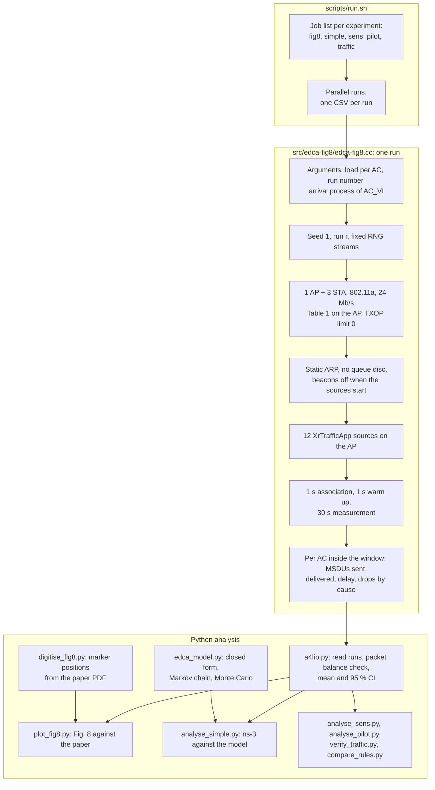

# <center>A4 — Baseline Reproduction</center>


## 1 Overview


I reproduce **Fig. 8 of Mangold et al. (2003)** in ns-3.48: throughput per access category (AC) against the offered traffic per AC, with the AP as the only transmitter (12 downlink streams, 3 per AC).


## 2 Scenario and parameters


| Parameter | Value | Source |
| :--- | :--- | :--- |
| Topology | 1 AP, 3 stations at 5 m, 12 downlink streams (one per AC and station) | Paper |
| PHY | 802.11a, 20 MHz, channel 36, data and ACK at 24 Mb/s | Paper |
| EDCA (AIFSN / CWmin / CWmax) | VO 2 / 3 / 7, VI 2 / 7 / 15, BE 3 / 15 / 1023, BK 7 / 15 / 1023 | Paper, Table 1 |
| TXOP limit, RTS/CTS, fragmentation | 0 (one frame per TXOP), off, off | Paper |
| Beacons | Off from the start of the sources (stations associate before) | Paper |
| Traffic | Poisson, 512 byte MSDUs, same load on all four ACs | Paper |
| MSDU | LLC/SNAP 8 + IP 20 + UDP 8 + payload 476 byte | My choice |
| Channel | Error free (paper: radio channel error model) | My choice |
| MAC queue, MSDU lifetime, retry limit | 500 packets per AC, 500 ms, 7 (ns-3 defaults) | Not in the paper |
| Above the MAC | No queue disc, static ARP entries | My choice |
| Load points | 1.5, 3, 3.6, 4.2, 4.5, 6, 7.5, 9, 12, 15, 18, 30 Mb/s per AC | Markers of Fig. 8 |
| Timing | Sources start at 1 s, 1 s warm up, 30 s measured | Not in the paper |
| Seed and runs | Seed 1, run numbers 1 to 10, fixed RNG streams (Wi-Fi from 100, sources from 1000) | Not in the paper |
| Statistics | Mean over the runs, 95 % Student t confidence interval | Paper: LRE, 5 % |
| Software | ns-3.48,  g++ 13.3, Python 3.13, numpy 2.5.3, scipy 1.18.1, matplotlib 3.11.2 | |


## 3 Flowchart and source code




```
ln -s ~/projects/MWN-2026-F11502002-Sascha/A4-baseline/src/edca-fig8 \
  ~/ns-allinone-3.48/ns-3.48/scratch/edca-fig8
cd ~/projects/MWN-2026-F11502002-Sascha/A4-baseline

./scripts/run.sh all                                    # fig8, simple, sens, pilot, traffic
python scripts/edca_model.py --rounds 400000 --seeds 10 # reference model
python scripts/plot_fig8.py                             # results/fig8/
python scripts/analyse_simple.py                        # results/simple/
python scripts/analyse_sens.py                          # results/sens/
python scripts/verify_traffic.py --streams 3 --fps 60   # results/traffic/
python scripts/analyse_pilot.py                         # results/pilot/
```

furst script run took 58 minutes

## 4 Validation


## 5 Numerical results: Fig. 8 against the paper


