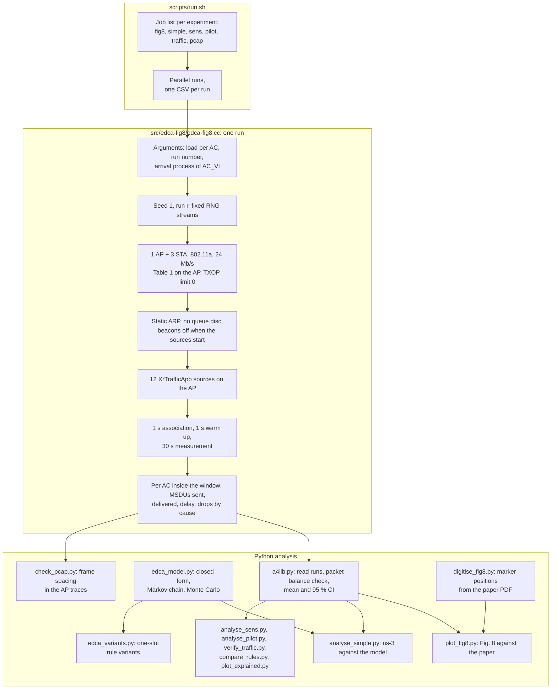
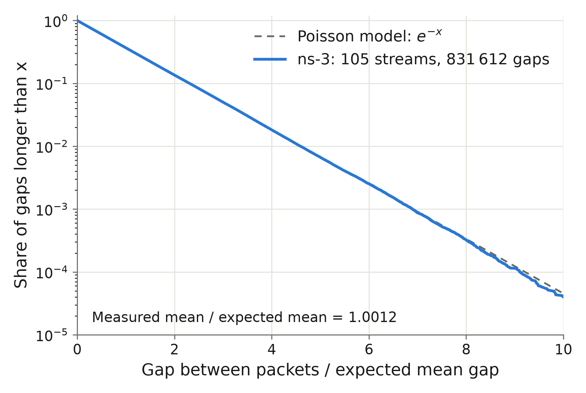
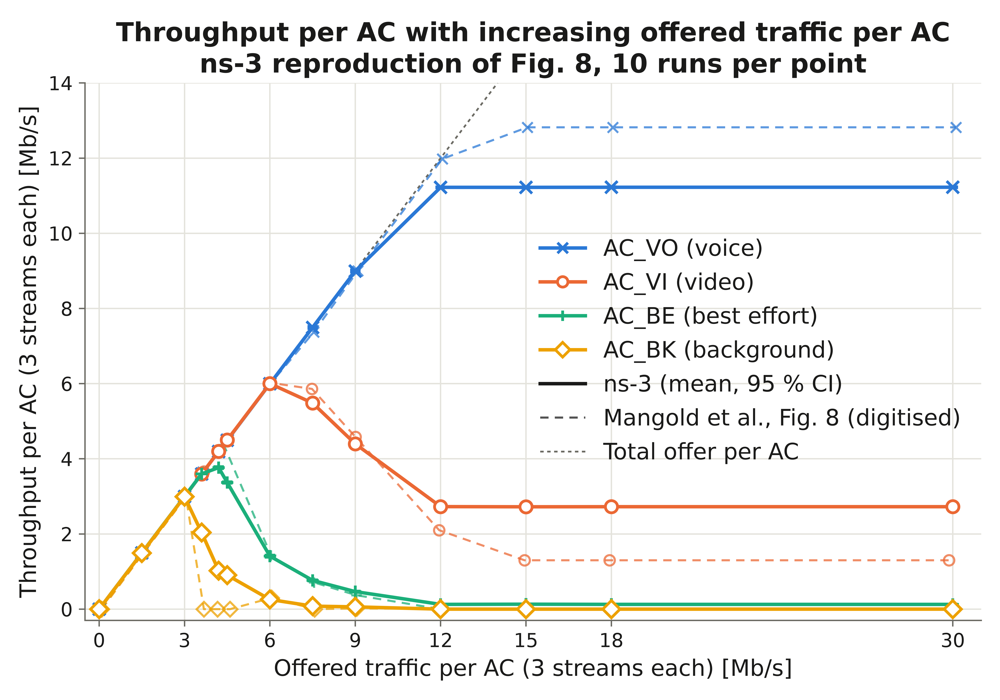
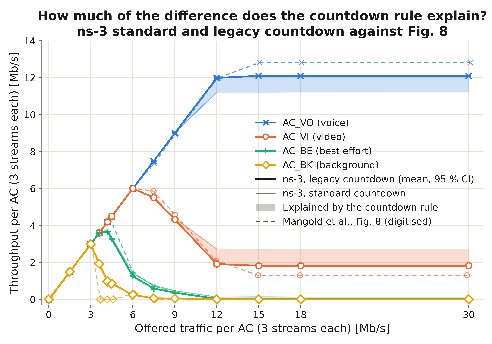
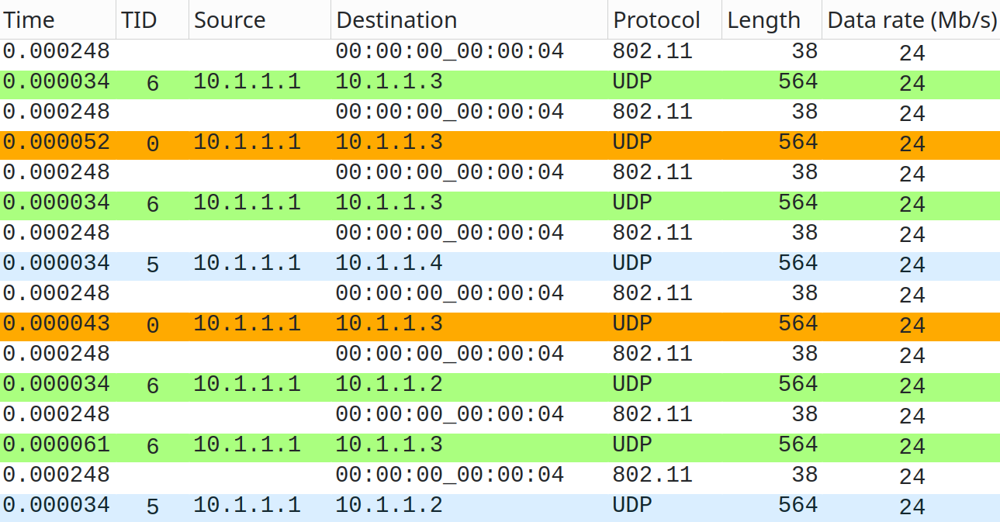

# <center>A4 — Baseline Reproduction</center>

- [A4 — Baseline Reproduction](#a4--baseline-reproduction)
  - [1 Overview](#1-overview)
  - [2 Scenario and parameters](#2-scenario-and-parameters)
  - [3 Flowchart and source code](#3-flowchart-and-source-code)
  - [4 Validation](#4-validation)
  - [5 Numerical results: Fig. 8 against the paper](#5-numerical-results-fig-8-against-the-paper)
  - [6 Differences and their causes](#6-differences-and-their-causes)
  - [7 Baseline for the final project: hypothesis and pilot](#7-baseline-for-the-final-project-hypothesis-and-pilot)


## 1 Overview


I reproduce **Fig. 8 of Mangold et al. (2003)** in ns-3.48: throughput per access category (AC) against the offered traffic per AC, with the AP as the only transmitter (12 downlink streams, 3 per AC).


## 2 Scenario and parameters


| Parameter | Value | Source |
| :--- | :--- | :--- |
| Topology | 1 AP, 3 stations at 5 m, 12 downlink streams (one per AC and station) | Paper |
| PHY | 802.11a, 20 MHz, channel 36, data and ACK at 24 Mb/s | Paper |
| EDCA (AIFSN / CWmin / CWmax) | VO 2 / 3 / 7, VI 2 / 7 / 15, BE 3 / 15 / 1023, BK 7 / 15 / 1023 | Paper, Table 1 |
| TXOP limit, RTS/CTS, fragmentation | 0 (one frame per TXOP), off, off | Paper |
| Beacons | Off from the start of the sources (stations associate before) | Paper |
| Traffic | Poisson, 512 byte MSDUs, same load on all four ACs | Paper |
| MSDU | LLC/SNAP 8 + IP 20 + UDP 8 + payload 476 byte | My choice |
| Channel | Error free (paper: radio channel error model) | My choice |
| MAC queue, MSDU lifetime, retry limit | 500 packets per AC, 500 ms, 7 (ns-3 defaults) | Not in the paper |
| Above the MAC | No queue disc, static ARP entries | My choice |
| Load points | 1.5, 3, 3.6, 4.2, 4.5, 6, 7.5, 9, 12, 15, 18, 30 Mb/s per AC | Markers of Fig. 8 |
| Timing | Sources start at 1 s, 1 s warm up, 30 s measured | Not in the paper |
| Seed and runs | Seed 1, run number r per run (see the table below), fixed RNG streams (Wi-Fi from 100, sources from 1000, burst phases 900) | Not in the paper |
| Statistics | Mean over the runs, 95 % Student t confidence interval | Paper: LRE, 5 % |
| Software | ns-3.48, optimized build. Build profile and compiler are recorded per experiment in `sweep.txt`, Python packages in [requirements.txt](../requirements.txt) | |

| Experiment | Configurations | Runs per configuration | Measured per run |
| :--- | :--- | ---: | ---: |
| `fig8`: Fig. 8, stock ns-3 | 12 load points | 10 (run 1 to 10) | 30 s |
| `fig8` in `results-legacy`: patched countdown rule | 12 load points | 10 (run 1 to 10) | 30 s |
| `simple`: validation ladder | 7 cases, saturated (30 Mb/s per active AC) | 5 (run 1 to 5) | 30 s |
| `sens`: unreported parameters | 7 variants at 3.6 and 30 Mb/s | 3 (run 1 to 3) | 30 s |
| `traffic`: source verification | Poisson at 3 Mb/s per AC, bursts at 5.9 Mb/s | 8 and 1 | 30 s |
| `pilot`: burstiness | 3 arrival processes at 2.95, 5.90, 8.85 Mb/s | 10 (run 1 to 10) | 30 s |
| `pcap`: AP traces | 3.6 and 30 Mb/s | 1 (run 1) | 0.5 s |
| Reference model | 7 AC subsets, 2 countdown rules | 10 seeds (numpy), 400 000 frame exchanges each | |
| Model variants | 8 rule variants | 3 seeds, 150 000 frame exchanges each | |

Every ns-3 result is repeatable bit for bit from (seed 1, run number, arguments), which `run.sh` records in `sweep.txt` next to the raw CSV files.


## 3 Flowchart and source code




```
ln -s ~/projects/MWN-2026-F11502002-Sascha/A4-baseline/src/edca-fig8 \
  ~/ns-allinone-3.48/ns-3.48/scratch/edca-fig8
cd ~/projects/MWN-2026-F11502002-Sascha/A4-baseline

./scripts/run.sh all                                    # fig8, simple, sens, pilot, traffic, pcap
python scripts/edca_model.py --rounds 400000 --seeds 10 # reference model
python scripts/edca_variants.py --rounds 150000 --seeds 3  # results/model/variants.md
python scripts/plot_fig8.py                             # results/fig8/
python scripts/analyse_simple.py                        # results/simple/
python scripts/analyse_sens.py                          # results/sens/
python scripts/verify_traffic.py --streams 3 --fps 60   # results/traffic/
python scripts/analyse_pilot.py                         # results/pilot/
python scripts/check_pcap.py                            # results/pcap/
```

The legacy countdown sweep needs a patched ns-3, see section 6. `digitise_fig8.py` needs the paper PDF, which is not in the repository (due to copyright); its output is [reference/mangold_fig8.csv](reference/mangold_fig8.csv).

first simulation run took 58 minutes\
analysis scripts run took 4 minutes

[source code ns-3](src/edca-fig8/)\
[analysis scripts](scripts/)

## 4 Validation

Before comparing with the paper, I check the simulation against values I can calculate myself, from the simplest case upwards.

**Step 0, traffic source.** 105 Poisson streams (9 runs): the mean inter-arrival time is 1.0012 ± 0.0010 times the model value, and the KS p-values are uniformly distributed (p = 0.34, 8 % below 0.05). The burst source sends exactly 8 MSDUs every 16.667 ms. Details: [results/traffic/traffic.md](results/traffic/traffic.md).



For a Poisson source the gap between packets, divided by its expected mean, follows e^(−x): a straight line on a logarithmic axis. The 831 612 measured gaps lie on that line down to 10⁻⁴ (`plot_slides.py`).

**Step 1, one saturated AC alone.** Without contention every frame exchange takes the same time on average:

$$T = \text{SIFS} + \text{AIFSN} \cdot \sigma + \frac{CW_{min}}{2} \cdot \sigma + T_{DATA} + \text{SIFS} + T_{ACK}, \qquad S = \frac{4096 \text{ bit}}{T}$$

with σ = 9 µs, SIFS = 16 µs, $T_{DATA}$ = 20 + 4 · ⌈(16 + 8 · 542 + 6) / 96⌉ = 204 µs (512 byte MSDU + 30 byte MAC header and FCS) and $T_{ACK}$ = 28 µs. For AC_VO: T = 16 + 18 + 13.5 + 204 + 16 + 28 = 295.5 µs, S = 13.86 Mb/s.

| AC | ns-3 (5 runs) | Hand calculation | Difference |
| :--- | ---: | ---: | ---: |
| AC_VO | 13.860 ± 0.002 | 13.861 | -0.01 % |
| AC_VI | 13.064 ± 0.003 | 13.065 | -0.01 % |
| AC_BE | 11.423 ± 0.007 | 11.425 | -0.02 % |
| AC_BK | 10.384 ± 0.003 | 10.383 | +0.02 % |

This confirms frame durations, ACK rate, AIFS, slot time, backoff range and the throughput measurement.

**Steps 2 to 4, several saturated ACs.** Reference: my own model of the saturated backoff entities of one station ([scripts/edca_model.py](scripts/edca_model.py)), which contains only the EDCA rules. For AC_VO + AC_VI the Markov chain over the backoff states is solved exactly (480 states), for three and four ACs the same rules are simulated (Monte Carlo, 10 seeds of 400 000 frame exchanges).

| Case | AC | ns-3 (5 runs) | Model | ns-3 minus model |
| :--- | :--- | ---: | ---: | ---: |
| VO + VI | AC_VO | 11.322 ± 0.018 | 11.318 (exact) | +0.004 |
| | AC_VI | 2.748 ± 0.020 | 2.753 (exact) | -0.005 |
| All four (end of Fig. 8) | AC_VO | 11.227 ± 0.023 | 11.223 ± 0.003 | +0.005 |
| | AC_VI | 2.725 ± 0.021 | 2.728 ± 0.003 | -0.003 |
| | AC_BE | 0.125 ± 0.013 | 0.128 ± 0.001 | -0.003 |
| | AC_BK | 0.000 | 0.000 | 0.000 |

All differences are inside the confidence intervals, also for VO + VI + BE ([results/simple/simple.md](results/simple/simple.md)). The model replaces the analytical models of Kong et al. and Huang and Liao planned in the A3 proposal: with a single station the system is small enough to be solved without their approximation of a constant collision probability.

**Step 5, below saturation.** As long as the sum of the offered traffic fits into the capacity of about 13.9 Mb/s, every AC must carry its offer. With four equal loads this ends at 13.9 / 4 ≈ 3.5 Mb/s per AC. In ns-3 all four ACs carry their offer at 3 Mb/s, and AC_BK loses at 3.6 Mb/s, as in the paper.


## 5 Numerical results: Fig. 8 against the paper




- **Matches:** up to 3 Mb/s per AC every AC carries its offer (within 0.05 Mb/s of the paper), the ACs lose throughput in the order BK, BE, VI, AC_VO saturates from 12 Mb/s on, and the total at overload is 14.08 against 14.12 Mb/s.
- **Does not match:** the split between AC_VO and AC_VI at overload, and the AC_BK collapse at 3.6 to 4.5 Mb/s (section 6).
- **Precision:** the 95 % confidence interval is at most ± 0.03 Mb/s and below 2 % of the mean for every point above 1 Mb/s, so no difference in section 6 is caused by too few runs.

All 12 load points with confidence intervals: [results/fig8/comparison.md](results/fig8/comparison.md), loss and delay per AC: [results/fig8/summary.csv](results/fig8/summary.csv).


## 6 Differences and their causes


| # | Difference | Cause | Evidence | Status |
| :-- | :--- | :--- | :--- | :--- |
| 1 | Overload (15 Mb/s and above): AC_VO 11.2 instead of 12.8, AC_VI 2.7 instead of 1.3, AC_BE 0.13 instead of 0 | Backoff countdown rule. ns-3 follows IEEE 802.11-2020: a waiting AC also counts down at the slot boundary at the end of its AIFS, so it gains one slot per busy period | With a DCF like countdown (one decrement per idle slot) the model gives 12.10 / 1.82 / 0.03, and a patched ns-3 gives 12.10 / 1.82 / 0.02 | 55 % (AC_VO) and 64 % (AC_VI) of the gap explained, the rest is open (see below) |
| 2 | Knee of AC_VO at 12 Mb/s: 11.22 instead of 11.92 | Same as 1 | Patched ns-3: 11.99 ± 0.04 | Explained |
| 3 | AC_BK at 3.6 to 4.5 Mb/s: 2.04, 1.02, 0.91 instead of about 0 | Unknown. In the paper up to 3 Mb/s of capacity stay unused at these points although AC_BK has traffic, in ns-3 AC_BK uses them | Not the queue size, lifetime, retry limit or beacons (AC_BK stays at 2.04 to 2.05 ± 0.07 in all variants, 3 runs), not the countdown rule (1.92 at 3.6 Mb/s) | Not explained (see below) |
| 4 | AC_BE at 4.2 and 4.5 Mb/s: 3.77 and 3.37 instead of 4.19 and 4.16 | Consequence of 3: AC_BK still takes about 1 Mb/s | Sum of AC_BE and AC_BK: 4.79 and 4.28 in ns-3 | Follows from 3 |
| 5 | Total at overload: 14.08 instead of 14.12 | Inside the accuracy of the digitisation | | No difference |
| 6 | Radio channel error model in the paper, error free channel here | Unmodelled effect | Not simulated. The paper's total at overload lies inside the range of the error free rule variants (see below) | Bounded: at most about 2 % frame errors, if the paper's rules lie in the tested range |

The patched ns-3 is stock ns-3.48 with one statement removed ([patches/legacy-countdown.patch](patches/legacy-countdown.patch)), 10 runs per point: [results-legacy/fig8/explained.md](results-legacy/fig8/explained.md).



The sensitivity runs are in [results/sens/sens.md](results/sens/sens.md).


```
cd ~/ns-allinone-3.48/ns-3.48
patch -p1 < ~/projects/MWN-2026-F11502002-Sascha/A4-baseline/patches/legacy-countdown.patch
cd ~/projects/MWN-2026-F11502002-Sascha/A4-baseline
./scripts/run.sh fig8 results-legacy      # sweep.txt records the md5 of the patched file
python scripts/plot_fig8.py --results results-legacy/fig8
python scripts/compare_rules.py           # fails if the legacy sweep equals stock ns-3
python scripts/plot_explained.py
cd ~/ns-allinone-3.48/ns-3.48   # back to stock ns-3 before any other run
patch -R -p1 < ~/projects/MWN-2026-F11502002-Sascha/A4-baseline/patches/legacy-countdown.patch
```
 The paper itself states that the first countdown occurs at the end of AIFS, which is the rule of ns-3. I therefore cannot say which rule its simulator, based on a 2003 draft, actually applied or what else differs.

**Remaining overload gap (row 1).** The split between AC_VO and AC_VI at overload depends on one-slot details of their arbitration. In the reference model, a single change of one slot reproduces the paper about as well as any other: AIFSN 3 for AC_VI gives 12.46 / 1.35 Mb/s, CWmin 15 for AC_VI with the legacy rule 12.58 / 1.31 Mb/s (paper 12.82 / 1.30, [results/model/variants.md](results/model/variants.md)). Several different details fit, so the paper's data cannot tell which one its simulator used. Without channel errors these variants give a total of 13.89 to 14.20 Mb/s at overload. Each frame error costs one frame exchange, so a frame error rate p lowers the total by roughly the share p. With p = 2 % even the highest variant would drop to 13.9 Mb/s, the lower end of the range, so the paper's 14.12 Mb/s leaves room for rare errors only.

**AC_BK collapse (row 3).** At 3.68 Mb/s per AC the paper shows AC_BK at 0 while the other three ACs carry their offer, about 11 Mb/s in total. These are about 2 680 frames per second. Each occupies the medium for 264 µs plus its AIFS (18 or 27 µs after the SIFS), together 76 % of the time, so about a quarter of the time the medium is idle while AC_BK has frames queued. Every ns-3 variant I ran (both countdown rules, queue size, MSDU lifetime, retry limit, beacons) lets AC_BK use this idle time: 1.92 to 2.05 Mb/s at 3.6 Mb/s. The paper's own AC_BK curve is also not monotonic: 0 at 3.7 to 4.6 Mb/s, then 0.30 at 6.1 Mb/s (ns-3: 0.26), then 0 again. In ns-3 AC_BK falls monotonically with the load, as expected when the other ACs only get more traffic; a rule that starves AC_BK at 3.7 Mb/s would also starve it at 6 Mb/s. I therefore consider the zeros at 3.7 to 4.6 Mb/s a property of the reference (measurement or statistics), not of the EDCA rules; the paper does not report run length, warm up or how throughput is counted for an unstable queue.

**PCAP.** Two traces of the AP (`run.sh pcap`: 0.5 s measured, 3.6 and 30 Mb/s per AC) are in [results/pcap/](results/pcap/). In both, the time between the starts of consecutive downlink data frames is always 264 µs plus a whole number of 9 µs slots, and no AC transmits before its AIFSN ([results/pcap/pcap.md](results/pcap/pcap.md), `check_pcap.py`). Virtual collisions leave no trace on the air: only the winner transmits. In Wireshark: filter `wlan.fc.type_subtype == 0x0028 && wlan.fc.fromds == 1`, columns `wlan.qos.tid` and `frame.time_delta_displayed`.



ns-3 stamps a sent frame at the start of its transmission and a received frame at the end of its reception. In the screenshot, DATA → ACK is therefore 204 + 16 + 28 = 248 µs, and ACK → DATA is 16 µs + 9 µs · (AIFSN + backoff), at least 34 µs for AC_VO and AC_VI and 43 µs for AC_BE.


## 7 Baseline for the final project: hypothesis and pilot

**Feedback on A3:** what is the hypothesis, and can burstiness be tested in this scenario, since it only becomes visible through contention?

**What contends.** The four backoff entities of the AP contend with each other (virtual collisions). The three AC_VI streams share one queue and do not contend with each other.

**Expectation from background knowledge.**

1. Throughput cannot show burstiness: below the capacity every AC carries its offer, and in overload the AC_VI queue is always backlogged, whatever the arrival process is.
2. AC_VO wins every virtual collision. How often AC_VI wins a round against AC_VO depends only on whether AC_VI has a frame, not on how many frames are queued, so a burst does not block AC_VO longer than a single frame.
3. A burst of N MSDUs delays its own packets: packet k waits for k frame exchanges, on average (N + 1) / 2 of them.

**Pilot.** AC_VI as Poisson source against AC_VI as periodic bursts (60 frames/s per stream, 4, 8 and 12 MSDUs of 512 byte per frame), at the same mean load, with independent and with aligned frame phases of the three streams. The other ACs stay Poisson. 10 runs each.

| Metric | Load per AC | Poisson | Bursts, random phases | Bursts, aligned phases |
| :--- | ---: | ---: | ---: | ---: |
| Throughput, largest change of any AC [Mb/s] | all | | 0.02 | 0.02 |
| AC_VO mean delay [ms] | 2.95 | 0.40 | 0.40 | 0.40 |
| | 5.90 | 0.64 | 0.64 | 0.64 |
| AC_VI mean / 99 % delay [ms] | 2.95 | 0.56 / 2.15 | 1.25 / 3.50 | 2.89 / 6.92 |
| | 5.90 | 5.57 / 27.5 | 5.82 / 16.5 | 9.06 / 22.5 |
| | 8.85 | 452 / 498 | 448 / 496 | 445 / 493 |
| AC_BE mean delay [ms] | 2.95 | 1.35 | 1.44 | 1.66 |
| AC_VI incomplete frames [%] | 8.85 | 50 (MSDUs lost) | 87 | 65 |


Full tables with confidence intervals: [results/pilot/pilot.md](results/pilot/pilot.md).

1. **Throughput does not change.** 23 of 24 differences have a confidence interval that includes zero, the remaining one is 0.016 ± 0.014 Mb/s.
2. **AC_VO hardly notices the bursts.** Its mean delay is the same for all three arrival processes at all loads. Only at 8.85 Mb/s with aligned phases is its 99 % delay slightly higher (5.01 ± 0.14 against 4.82 ± 0.11 ms), at the edge of the confidence intervals.
3. **AC_VI delays itself.** At 2.95 Mb/s with aligned phases 12 MSDUs arrive together. One AC_VI frame exchange takes 0.31 ms (step 1), so (12 + 1) / 2 · 0.31 ms = 2.0 ms is the lower bound. 2.89 ms is measured, because the other ACs transmit in between. Three streams only add up when their phases align (2.89 against 1.25 ms).
4. **Near saturation the order reverses.** At 5.90 Mb/s the Poisson source has the longer tail (99 %: 27.5 against 16.5 ms), because a periodic source has no long clusters of arrivals.
5. **In overload only the frame level differs.** With half of the MSDUs lost, 65 to 87 % of the video frames are incomplete.

**Consequence.** The feedback is correct for throughput and for the other ACs: with a single transmitter, burstiness of AC_VI is not passed on to AC_VO. My expectation that three streams make the effect visible holds only for the delay of AC_VI itself. The hypothesis for the final project is therefore stated on delay and frame loss, with throughput as the control:

| # | Hypothesis (3GPP traffic on AC_VI against Poisson, same mean load) | Metric |
| :-- | :--- | :--- |
| H1 | The throughput per AC does not change | Fig. 8 axis, difference with confidence interval |
| H2 | The delay of AC_VI grows with the burst size at low load and is shorter in the tail near saturation | Mean and 99 % packet and frame delay |
| H3 | AC_VO is not affected as long as the AP is the only transmitter | Delay CCDF of AC_VO |
| H4 | In overload the frame loss is much higher than the packet loss | Share of incomplete frames |

**Decision for the final project:** the stations send the uplink pose stream of A2 (AC_VO, 60 byte payload every 10 ms), so that the downlink bursts meet real collisions. This also follows the feedback that XR video without uplink pose data is unrealistic. H3 then becomes: the delay and loss of the pose stream do not change when AC_VI switches from Poisson to the 3GPP model at the same mean load. The option is already in the scenario (`--uplinkPose=true`, off by default, the A4 results are bit for bit the same with the new code). It has only been smoke tested, there are no results yet.